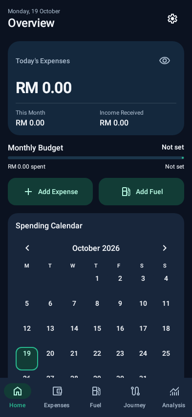
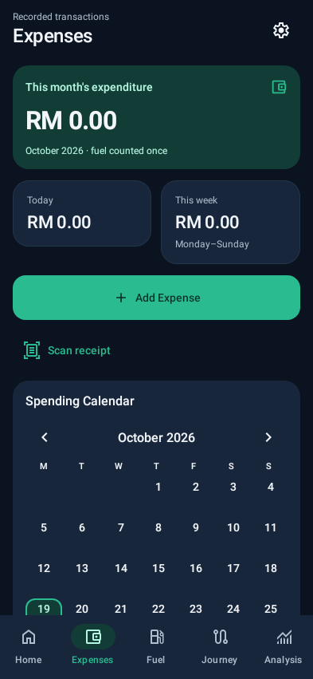
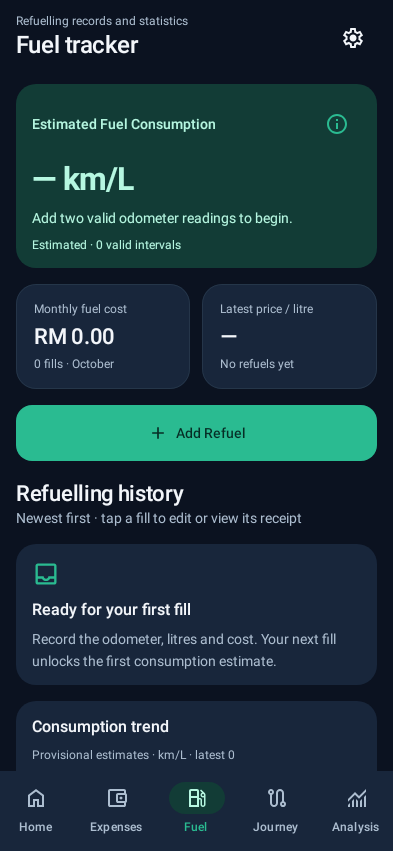
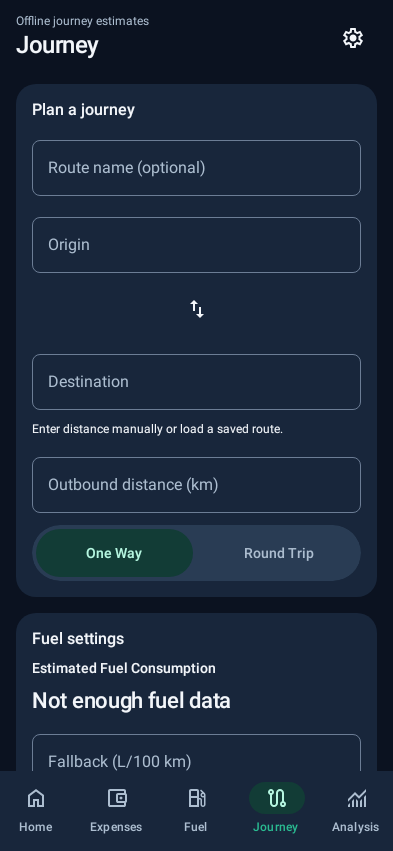
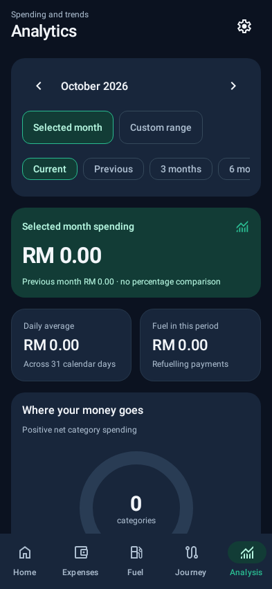

# 1. How to learn from your own application

This book explains how your Fuel & Expense Tracker works and how to maintain an application like it. You do not need to know Kotlin before starting. You do need to practise: read a small section, predict what the code will do, run a controlled experiment, and compare the result with your prediction.

The reference application is version **1.5.4**, Android version code **11**, package **my.fuelledger**, at source checkpoint **1f13482bfc550da77e5c950e48075f62de12620f**. The material was prepared on **21 October 2026**. References to “current implementation” mean that checkpoint. Later improvements may change file names, line numbers or behavior. Historical investigation reports describe their own earlier checkpoints.

Your app is a substantial example: expenses, refunds, refuelling, journey estimates, recurring commitments, monthly allocations, charts, local receipt recognition, encrypted persistence, backups, accessibility and release management all interact. Learning why those interactions are safe is more useful than memorizing every line.

The guide has four kinds of material:

- **Explanation:** a concept, the reason for using it, and its tradeoffs.
- **Worked example:** invented financial records with calculations you can reproduce.
- **Source reading:** a real file or function in the accompanying source snapshot.
- **Practice:** an exercise on a disposable learning branch or test fixture.

Short teaching snippets are intentionally smaller than production implementations. They are labelled as examples, not replacements for whole source files. The source-reading appendix contains exact excerpts. The companion archive contains the actual source, tests, configuration, migration schemas and relevant project documentation. It excludes financial records, credentials, build caches and APK binaries.

## A manageable learning route

For a first pass, study Chapters 1–8, then money and expenses in Chapters 9–10. You should be able to explain how a button press becomes a saved record before moving to receipts and encryption. On a second pass, study fuel, planning, journeys and analytics. On a third pass, study security, debugging, testing and releases.

A suggested eight-week route is:

| Week | Focus | Evidence that you understand |
|---|---|---|
| 1 | Tools, Kotlin, types and functions | Explain a small function without reading its comments |
| 2 | Compose, state and architecture | Trace amount entry from UI to repository |
| 3 | Money, expenses, Room and migrations | Write a test that catches incorrect sen conversion |
| 4 | Fuel, journeys and planning | Work out expected results by hand |
| 5 | Receipt parsing and files | Explain why an ambiguous receipt needs review |
| 6 | Privacy, encryption and backups | Distinguish five different kinds of key or password |
| 7 | Debugging, tests and accessibility | Reproduce and isolate a fault in a fixture |
| 8 | Git, Codex and release management | Deliver one small reviewed change with evidence |

Go slower if necessary. A useful learning session ends with a concrete result: a diagram, a passing test, an explained function or a corrected misunderstanding.

## What “complete” means here

This is a complete learning path through the major engineering responsibilities of this particular app. It is not a substitute for every Android API reference or an exhaustive computer-science degree. Native Android development also includes subjects this app does not need, such as multiplayer networking, payment processing and server authentication.

The book distinguishes implemented behavior, historical test evidence and proposed exercises. A screenshot does not prove calculation correctness. A passing unit test does not prove a camera works on every phone. A successful build does not prove a safe update.

**First exercise:** explain the difference between a record, a screen and a calculation. An expense record is persisted data; the Expenses screen displays a selection of records; a monthly total is a calculation over those records. Changing the display order should not rewrite the records.

# 2. Why Kotlin, Compose and these supporting technologies?

The app uses **Kotlin** because it is a well-supported language for native Android development and works directly with Jetpack Compose, coroutines and Android libraries. Kotlin offers concise data classes, nullable types, collection operations and good Java interoperability. Those features reduce repeated code and make some errors easier to detect.

Kotlin does not automatically produce correct financial calculations, secure storage or an attractive interface. A badly designed Kotlin program can lose data just as easily as a badly designed Java program. The quality comes from explicit rules, careful implementation and verification.

## Why not another language?

Java remains a valid Android language and is useful for understanding older libraries. Kotlin makes the current Compose and coroutine code more natural to express. Flutter with Dart can share a UI across Android and iOS; React Native with JavaScript or TypeScript can share application code with a web-oriented team. Those approaches have their own tooling and native-integration tradeoffs.

For this existing Android-only app, changing language or framework would introduce migration work without solving a demonstrated problem. Preserving the working architecture is the sensible engineering choice. If iOS later becomes a firm requirement, compare options using actual staffing, platform integration and maintenance costs.

## Which technology does which job?

| Technology | Job in this project | Why it is useful |
|---|---|---|
| Kotlin | Application and test logic | Types, null safety, Android integration |
| Jetpack Compose | Screens and interactive controls | UI is a function of observable state |
| Material 3 | Components, typography and theme roles | Consistent accessible building blocks |
| ViewModel and StateFlow | Screen state and ongoing work | State can survive Activity recreation |
| Room | Database mapping, queries and migrations | Checked SQL interfaces and observable queries |
| SQLCipher | Encrypted SQLite storage | Database contents are encrypted at rest |
| DataStore | Local application preferences | Observable, structured preference persistence |
| Bundled ML Kit | On-device text recognition | Recognition model is included in the APK |
| WorkManager | Deferrable recurring work | Android-managed background scheduling |
| Android Keystore | Protect local cryptographic keys | Keys need not be stored as plain app files |
| Tink | Authenticated streaming backup encryption | Maintained cryptographic construction |
| Gradle and KSP | Build orchestration and generated Room code | Repeatable compilation and schema processing |
| Python | Release verification and automation | Explicit artifact and metadata checks |

The project also uses XML for manifest declarations, adaptive icons, some resources and home-screen widgets. XML is not obsolete because the main UI uses Compose. Java appears in the build policy that checks and transforms a particular ML Kit dependency. SQL appears in Room queries and migrations. Each language serves a specific layer.

## Understand versions before changing them

At the reference checkpoint, the project uses Kotlin 2.3.20, Gradle 9.6 and Android Gradle Plugin 9.4.1. These are snapshot facts, not a recommendation to put these versions into every future project.

The environment uses **JDK 21**, while the app targets **Java/Kotlin bytecode level 17**. These are different from **minSdk 26**, **compileSdk 37** and **targetSdk 37**:

- The JDK runs the compiler and build tools.
- The bytecode target controls a compilation compatibility level.
- minSdk specifies the oldest supported Android API level.
- compileSdk supplies Android APIs available at compilation.
- targetSdk declares the Android behavior level the app has been prepared to support.

Raising compileSdk does not automatically make new APIs safe on older devices. Calls introduced after API 26 may need a version check or a compatible library.

**Common mistake:** upgrade every dependency at once after a build error. That creates several moving targets. First identify the failing tool, inspect the pinned configuration, and change the smallest necessary part.

**Source reading:** `app/build.gradle.kts`, root `build.gradle.kts`, `buildSrc/build.gradle.kts` and the wrapper properties. This snapshot declares dependencies in Gradle files; do not assume a version catalog exists.

# 3. Requirements, invariants and honest product design

Before designing a screen, define what the application is responsible for. This app records financial events and calculates estimates. It is not connected to a bank and cannot know a real account balance merely from entered expenses.

A **requirement** describes desired behavior. An **invariant** is a condition that must remain true through every permitted operation. “Add a refuelling form” is a requirement. “A refuelling purchase must contribute only once to total expenditure” is an invariant.

Important invariants in this app include:

- Money is stored in exact sen, not floating-point ringgit.
- A linked refuel has at most one linked expense.
- A refund cannot exceed the remaining refundable amount of its purchase.
- A recurring occurrence cannot create the same payment twice.
- Allocation percentages total exactly 100% before saving.
- Planned reserves are not actual transactions.
- An ambiguous receipt cannot bypass review through smart auto-save.
- Updating appearance does not rewrite financial records.
- An app update preserves package identity, signing identity and compatible data.

These rules belong in the data/domain layer as well as the UI. A disabled Save button helps the user, but it is not enough: imports, background jobs, tests and future screens can call the repository directly.

## Write acceptance criteria you can observe

For cents-first entry, an observable criterion is: “Starting at zero, pressing 1, 2, 3 displays RM 1.23; pressing backspace displays RM 0.12.” “Make entry intuitive” is a design goal, but not a sufficient test.

For theme persistence: “Choose Dark, close and recreate the app, and observe Dark without changing the stored expenses.” For duplicate receipts: “Submit two concurrent save requests with the same normalized fingerprint; no more than one receipt transaction is committed.”

Specify failure behavior too. If the amount is zero, Save is disabled. If a database key is unavailable, existing files are preserved and the failure is reported. If OCR cannot read a date, the interface asks for review rather than inventing today's date.

## Design with the user’s mental model

Use plain labels with units: “Distance (km),” “Consumption (L/100 km)” and “Monthly allocation.” Distinguish *expected* income from *received* income. Distinguish an estimate from a measurement. A beautiful monetary figure with an unclear meaning is a poor financial interface.

One-handed operation favors accessible actions near the lower part of the screen. It does not justify hiding important validation. Large text should remain readable; permit scrolling and wrapping rather than shrinking every element to make a screenshot look tidy.

Choose data retention intentionally. Receipt photos can contain personal information. The app allows the user to retain a private copy or remove an image while preserving the financial transaction. Those are different user decisions and need different operations.

## Scope and change control

The project has evolved through many requests. An older request may say “Home, Fuel, Expenses,” while the current implementation may use a later navigation order. When learning, inspect the actual current code and dated reports. Do not silently treat every historical request as the final specification.

Before implementing a change, write: the problem, affected behavior, protected invariants, files likely involved and verification method. This five-line brief is often more valuable than immediately generating hundreds of lines.

**Practice:** propose a “duplicate expense” action. Decide which fields should copy and which must change. A new record needs a new ID. It should not inherit receipt duplicate ownership, a refuel link, a refund relationship or a recurring occurrence link without explicit rules.

# 4. Kotlin fundamentals using financial examples

A program is a set of precise instructions operating on data. Kotlin's type system tells the compiler what kinds of values are permitted. Reading the type often explains more than reading a variable's name.

```kotlin
// Teaching example: exact values, not a replacement entity.
val lunchSen: Long = 1250L
val description: String = "Lunch"
val hasReceipt: Boolean = false
var selectedCategoryId: String = "food"
```

`val` prevents assigning a different value to that variable. `var` permits reassignment. A `val` referring to a mutable list does not make the list immutable; prefer immutable data and explicit replacement when passing state through the UI.

`Long` is a signed 64-bit integer. `Double` is a floating-point number. Money in this app uses `Long`; physical measurements such as litres and distance use validated `Double` values. A type cannot supply units by itself: `7.0` could mean kilometres, litres or L/100 km. Names and function boundaries must make units clear.

## Functions and return values

```kotlin
// Teaching example.
fun remainingSen(allocatedSen: Long, spentSen: Long): Long {
    return allocatedSen - spentSen
}
```

This function takes two arguments and returns one result. It does not write a database, display a screen or change its inputs. Such **pure functions** are easy to test. In production, define valid ranges and overflow behavior as well as the formula.

An expression-body function can omit braces and `return`:

```kotlin
fun isOverspent(remainingSen: Long) = remainingSen < 0L
```

Use `if` and `when` for decisions. Do not duplicate a calculation in every branch when only the display label differs.

## Nullable values

`String?` means a string or `null`. A missing merchant is different from a merchant whose name is the literal word “Unknown.” `Double?` is useful when no valid fuel interval exists; zero efficiency would communicate a different and usually false fact.

```kotlin
val merchant: String? = null
val label = merchant ?: "Review merchant"
val characterCount: Int? = merchant?.length
```

`?:` supplies a fallback. `?.` calls only if the value is non-null. Avoid `!!`, which asserts non-null and crashes if the assertion is wrong. A fallback suitable for display may be unsuitable for saving. “Review merchant” must not silently become the stored merchant.

## Data classes, equality and copying

```kotlin
data class EntryDraft(
    val cents: Long,
    val categoryId: String,
    val note: String = ""
)
val original = EntryDraft(1200L, "food")
val revised = original.copy(note = "Team lunch")
```

A data class generates structural equality and `copy`. The revised value leaves the original unchanged. This supports predictable UI state and conflict-aware Undo. `==` checks value equality; `===` checks object identity. `copy` is shallow: nested mutable objects are still shared unless separately copied.

## Collections and lambdas

`filter` selects values, `map` transforms them, `groupBy` groups them, and `sumOf` totals a numeric property.

```kotlin
// Teaching example; real reporting also filters by date and zone.
val foodTotal = expenses
    .filter { it.categoryId == "food" }
    .sumOf { it.cents }
```

The braces contain a lambda; `it` is the current item. `List<Expense>` means a list whose elements are expenses. Sets are useful for repeated membership checks; maps connect IDs to values.

Use meaningful names in nested lambdas. A sequence of several `it` references can hide which object is being read. Also consider cost: filtering the entire list inside another loop can become quadratic.

## Exceptions and validation

`require(condition) { "Message" }` rejects invalid input with an exception. Repository callers convert expected validation failures into useful UI messages. Do not catch every exception and pretend the operation succeeded. Database, permission and cryptographic errors need different recovery paths.

Kotlin features to learn next include interfaces, extension functions, sealed classes, generics and annotations. In this project, `PreferencesStore` is an interface, `Expense.point()` is a transformation, and annotations such as `@Entity` and `@Composable` instruct tools about a declaration's role.

**Practice:** predict the result of `EntryDraft(1200, "food").copy(cents = 1300)`. Which properties change? Then explain why converting an absent amount to zero and saving it would violate the expense rules.

# 5. Reading the project and setting up a learning workspace

The top level contains build configuration, the Gradle wrapper, application code, scripts, documentation and release history. Inside `app/src/main`, Kotlin code and resources become the application. `app/src/test` contains host tests. `app/src/androidTest` contains tests that run on Android.

Start with this reading route:

1. `LedgerApplication.kt`: which long-lived dependencies are created?
2. `MainActivity.kt`: how does Android enter the Compose UI?
3. `ui/LedgerApp.kt`: how are screens, forms and navigation connected?
4. `LedgerViewModel.kt`: what state and operations does the UI observe?
5. `data/LedgerRepository.kt`: which rules apply when saving?
6. `data/Database.kt`: what is stored, queried and migrated?
7. `domain/Calculations.kt`: which formulas are independent of the UI?

You will not understand every symbol on the first pass. Identify the direction of calls, then return to unfamiliar details when you have a concrete question.

## Safe local setup

Use a separate clone or branch for experiments. Install Android Studio with the SDK versions required by the checked-out build, and use the project's wrapper rather than an unrelated global Gradle installation. Let Android Studio configure the local SDK path. Keep `local.properties`, signing files and personal test data out of Git.

```sh
git clone https://github.com/Piccol1001/ChatgptFuelConsumption.git
cd ChatgptFuelConsumption
git switch -c learning/first-exercise
./gradlew :app:testDebugUnitTest
```

On Windows, the wrapper command is `gradlew.bat`. The existing cloud setup has an environment script at `/workspace/.tooling/fuel-ledger-env.sh`; that path is specific to this environment and is not something a Windows learner should invent locally.

The source companion is a reproducible reading snapshot, not a bundle of every downloaded dependency. A first development build may need internet access to obtain Gradle, SDK components and Maven libraries. **Build-time downloads do not imply runtime networking in the app.** Conversely, an offline build is not proof that the app lacks network permissions.

## The build pipeline

Gradle configures tasks and resolves dependencies. Kotlin and Java are compiled. KSP generates Room implementations and schema information. Android resources and the manifest are merged. Bytecode is converted to DEX. A release build may shrink and optimize code and resources. Packaging and signing produce an APK.

When a task fails, identify the stage:

- Dependency resolution: repository access, version or cache issue.
- Compilation: invalid code or mismatched API usage.
- Resource processing: missing or malformed resource.
- Tests: behavior differs from the expected result.
- Packaging/signing: artifact or certificate problem.
- Installation: device compatibility, version or signature issue.

The first meaningful error is often more useful than the final “BUILD FAILED” line. Keep a small error diary: symptom, hypothesis, evidence, change and outcome.

**Practice:** locate the actual `versionName`, `versionCode`, `applicationId` and Room schema version. Explain why these four values serve different purposes. Do not change them merely to practise finding them.


# 6. Architecture: follow one expense through the application

The app uses a practical layered structure. Compose displays state and emits user actions. ViewModels coordinate screen state and asynchronous work. Repositories enforce operations across storage. Room DAOs read and write records. Pure calculation functions turn records into summaries.

This resembles common MVVM and unidirectional-data-flow patterns, but it is not a perfectly isolated textbook architecture. Some models and calculations live together in `data`, and Android-aware ViewModels are used. Describe what exists before deciding to reorganize it.

```text
User taps Save
    |
Compose editor validates the visible draft
    |
ViewModel starts the operation and reports its state
    |
Repository validates business rules
    |
Room transaction / DAO writes encrypted database
    |
Observed Flow emits changed records
    |
ViewModel exposes state -> Compose redraws summaries
```

The downward path is an instruction. The upward path is observed data. A dashboard should not manually add the entered amount to a separate total and hope that its arithmetic stays synchronized with Room. Instead, derive the total from the same authoritative records.

## Dependency composition

`LedgerApplication` creates shared dependencies lazily. Its repositories use the same database. This is **manual dependency injection**: a class receives the objects it needs rather than creating a fresh database whenever a function runs. A large dependency-injection framework is not required to understand the principle.

For tests, replace a dependency with a controlled implementation. The `PreferencesStore` interface lets a test supply predictable settings behavior. For UI tests, fixture state can be supplied without accessing a person's real financial records.

Never create a new Room database or ViewModel inside each pager page during every composition. The page is a display surface, not a separate application. Activity-owned ViewModels and application-owned repositories keep work and state coherent.

## A detailed Save trace

Imagine entering RM 12.50 in Food, paying Cash, on 20 October. The editor stores 1250 sen in its draft. It must have a valid category and payment selection. Pressing Save passes a complete proposed record through a callback.

The ViewModel launches work in its scope and exposes progress or errors. `LedgerRepository.saveExpense` validates the record, checks that the category exists, applies rules for edits or refunds, records appropriate Undo information and writes through the DAO inside a transaction.

Room invalidates relevant observable queries. The ViewModel's collected state now contains the record. The Expenses list and monthly reporting functions calculate their results from that state. Success feedback is an event, not another financial transaction.

If validation fails, no partial record should appear. If storage fails, the UI should preserve the draft so the user can retry. If the UI closes during work, cancellation and operation completion must be handled intentionally.

## Ownership prevents hidden coupling

Ask “Who owns this value?” The editor owns an unsaved amount. The repository owns permission to commit a financial operation. Room owns persisted records. Theme settings belong to settings storage. A screen may display all of them without becoming their permanent owner.

**Common mistakes:** writing SQL directly from a Composable; storing one monthly total in several places; using a global mutable list as a database; putting every operation into a huge Activity; changing a category's stable ID when editing its display name.

**Practice:** draw the same trace for editing an existing expense. Mark where the ID stays unchanged, where validation runs again and where the old/new values support Undo.

# 7. State, lifecycle, coroutines and Flow

Android can recreate an Activity when configuration changes. It can also kill the app's process while it is in the background. A design that survives rotation may still lose unsaved work after process death. These are different cases.

| Mechanism | Appropriate role | Important limit |
|---|---|---|
| `remember` | Values retained during composition | Lost when that composition is removed |
| `rememberSaveable` | Small restorable UI values | Requires saveable types; not a file store |
| ViewModel | Screen state and operations | Does not inherently survive process death |
| SavedStateHandle | Small ViewModel restoration state | Not a substitute for persistent records |
| Room | Durable structured financial data | Requires successful commit |
| DataStore | Durable settings | Coordinate changes and migrations |

Use `rememberSaveable` for practical form restoration and scrolling state where supported. Do not put receipt bitmaps, entire database exports or huge transaction lists into saved-instance state. Save a small reference and reconstruct the view.

## Recomposition is normal

Compose may run a Composable function many times to reflect state changes. Recomposition is not equivalent to recreating the entire app. The function must be safe to execute repeatedly.

This is a dangerous teaching anti-example:

```kotlin
@Composable
fun BadScreen(repository: LedgerRepository) {
    // Do not start saves, OCR or database creation here.
}
```

Perform side effects in callbacks or lifecycle-aware effect APIs. `LaunchedEffect(key)` starts a coroutine associated with a particular composition and key; changing the key cancels and restarts it. `DisposableEffect` installs a resource or observer and cleans it up. The press-feedback implementation uses observer cleanup when monitoring system animation settings.

## Coroutines are structured asynchronous work

A `suspend` function can suspend without blocking its thread. It is not automatically a background-thread function. Blocking file access or image processing still needs an appropriate dispatcher. UI work belongs on the main thread; storage and blocking I/O commonly use `Dispatchers.IO`.

`viewModelScope.launch` ties a coroutine to the ViewModel lifetime. Child operations should generally remain within structured scopes rather than escaping into `GlobalScope`. On cancellation, release resources. Do not accidentally swallow `CancellationException` in a broad catch and continue writing.

`Mutex` serializes cooperating coroutine operations. A database transaction protects a different boundary: related database changes commit together or roll back together. One does not replace the other. A mutex in one repository is not a magical lock covering every repository and process.

## Flow and StateFlow

A `Flow` represents values over time. A Room observable query can emit when relevant tables change. A `StateFlow` holds a current state value and exposes subsequent updates. `stateIn` shares an upstream flow in a scope; the project uses subscription policies such as `WhileSubscribed(5000)` in its ViewModel state.

`collectAsStateWithLifecycle` connects collection to an appropriate Android lifecycle. This reduces unnecessary collection when the UI is inactive. It does not mean all upstream computation is free or all background work stops.

State and one-time events differ. The transaction list is state. “Expense saved” and an Undo offer are events. The project uses channels for some messages. Replaying a save operation merely because a screen re-collects state would be a serious bug.

## Avoid stale settings writes

Suppose two controls both read settings S. One changes the theme; the other changes haptics. If each writes a complete modified copy of S, the second can erase the first change. The repository's `updateSettings` reads the latest settings and applies a transformation under its write coordination.

A preference toggle should also not activate a global full-screen busy overlay. Small operations need appropriately scoped feedback; otherwise unrelated controls blink or appear to reload.

**Practice:** name which state should survive (a) recomposition, (b) rotation, (c) closing a form, and (d) process death. There is no universal “put everything in ViewModel” answer.

# 8. Room, relational data and migrations

A relational database stores tables of rows linked by keys. An expense has an ID, amount, category ID, timestamp and other fields. A category has a stable ID and a display name. The relationship uses the ID so a name can change without breaking historical associations.

Room maps Kotlin entities to SQLite tables and generates DAO implementations. SQLCipher supplies encrypted SQLite storage underneath. Room itself is not the encryption algorithm.

## Keys, indexes and relationships

A **primary key** uniquely identifies a row. A **foreign key** requires a referenced row to exist, subject to the declared relationship. An **index** speeds selected lookups; a unique index also prohibits duplicate non-null values for its key.

In the current model, expenses reference categories with deletion restricted and refuels with cascade deletion. The unique `fuelId` index prevents two expenses from owning the same refuel. Many ordinary expenses can have a null `fuelId`; SQLite permits multiple null values in such a unique index.

Deleting a custom category is therefore not just deleting its row. The repository first reassigns relevant records and mappings to Others. Deleting a refuel removes its linked expense through the intended relationship. Those are deliberate product semantics, not interchangeable defaults.

An index has a cost: extra storage and work during writes. Add one for a demonstrated query or constraint rather than indexing every column.

## Queries and transactions

```sql
-- Teaching example: use bound parameters, not string concatenation.
SELECT * FROM expenses
WHERE timestamp >= :start AND timestamp < :endExclusive
ORDER BY timestamp DESC
```

Bound parameters separate values from SQL syntax and avoid injection from ordinary input. A DAO can return a `Flow<List<Expense>>` for observed records or use a suspending function for a one-time result.

A transaction is needed when multiple rows form one logical operation. Saving a refuel and its linked expense must succeed together. Receipt acceptance writes an expense and duplicate-tracking information together. If only one write succeeds, the application can become inconsistent.

Transactions do not make all future operations valid. Undo must validate against current records, not only trust the values valid when the journal entry was written.

## Schema evolution

The current Room schema is version 5. Explicit migrations preserve records:

| Transition | Main additions |
|---|---|
| 1 → 2 | Fuel type, station location and receipt reference |
| 2 → 3 | Expense receipt/recurrence fields and finance tables |
| 3 → 4 | Recurrence uniqueness, income/manual rule metadata, merchant/scan, journey and planning tables |
| 4 → 5 | Merchant/refund fields, merchant preferences, favorites and Undo journal |

The exported JSON schemas are in `app/schemas`. They are a reviewable record of the expected schema, not a replacement for migration testing.

Adding a non-null column to an existing table usually requires an appropriate default for old rows. Renaming or changing a type may require a table-copy migration with explicit conversion. Never use destructive fallback just to silence a migration exception in an app holding real financial records.

## Three different compatibility questions

Can the new APK install over the old one? That depends on package/signing/version compatibility. Can the new database open old records? That depends on migration correctness. Can the new JSON model read old backup or journey payloads? That depends on serialization and model evolution.

Passing one of these does not prove the others.

**Practice:** design an optional “reference number” field. Decide whether it needs a column, how old rows read, what the backup validator accepts and which tests would demonstrate preservation. Do not implement it on the owner's data as a learning exercise.


# 9. Exact money and the cents-first keypad

Money is one of the most important type decisions in this app. RM 12.50 is stored as **1250 sen**, a `Long`. Formatting turns that integer into text for display. Parsing turns validated text into an exact integer.

Binary floating point cannot represent many decimal fractions exactly. Using `Double` for money and repeatedly adding rounded values can introduce disagreements. Storing integer minor units avoids that representation problem. It does not prevent overflow, incorrect signs or mistakes about which records to count.

The project centralizes money behavior in `Money` in `domain/Calculations.kt`. Manual input is parsed through `BigDecimal` and converted with an exact operation. Invalid fractional sen are rejected. Estimated values use a specified rounding rule, `HALF_UP`, at the appropriate monetary boundary.

```text
Stored:       125050 sen
Decimal:      1250.50 ringgit
Display:      RM 1,250.50
```

Never parse the formatted display string by simply calling `toDouble()`. It contains a currency prefix and grouping characters. Keep the numeric value separate from presentation.

## Deriving the keypad

Let `c` be the current amount in sen and `d` the next digit. Appending a digit is:

```text
new amount = c × 10 + d
```

Starting at zero:

| Key | Stored sen | Display |
|---|---:|---|
| 1 | 1 | RM 0.01 |
| 2 | 12 | RM 0.12 |
| 3 | 123 | RM 1.23 |
| 4 | 1234 | RM 12.34 |
| 5 | 12345 | RM 123.45 |
| Backspace | 1234 | RM 12.34 |
| Clear | 0 | RM 0.00 |

Integer division by ten removes the last digit. Leading zeroes remain zero until a nonzero digit is entered. No decimal-point button is needed.

The production `appendSenDigit` checks the bound *before multiplying*:

```kotlin
if (cents > (MAX_CENTS - digit) / 10) return null
return cents * 10 + digit
```

Checking only after multiplication is unsafe because overflow may already have occurred. `MAX_CENTS` is 100,000,000,000 sen in this snapshot, equivalent to RM 1,000,000,000. A permitted per-record amount does not automatically make every aggregate sum safe; future changes must consider total bounds as well.

Editing an expense initializes the keypad directly from its saved sen. A stored 1250 must display RM 12.50. Multiplying it by 100 again would show RM 1,250.00 and corrupt the user's intention.

## Rounding policy

A unit fuel price can have more precision than a final payable amount. Keep the price as decimal text/`BigDecimal`, calculate with sufficient precision, then round the final cost to sen. Avoid constructing `BigDecimal` directly from an imprecise binary value such as `0.1`; use a decimal string or the deliberately chosen conversion API.

For an allocation, independently rounding every percentage can make the total differ by a sen. Chapter 13 explains how the project distributes the remainder.

**Common mistakes:** storing ringgit in an integer column described as sen; rounding twice; treating zero as an acceptable expense; replacing an invalid amount with zero; forgetting that refunds are negative; allowing an unchecked long sum to wrap.

**Practice:** enter 0, 0, 7, 5, backspace, 0. The final stored amount is 70 sen and the display is RM 0.70. Write this expectation before running the test.

# 10. Expenses, categories, payment history, refunds and Undo

An expense is a durable financial event, not merely a line of UI text. Its ID remains stable during an edit. Category and payment labels are presentation choices layered over stored meaning.

## Category selection

The entry screen uses an icon row, including custom categories. Others is ordered last. The main Expenses screen has its own filter row; filtering a list must not mutate the entry screen's selected category or rewrite records.

The current manual-entry category helper excludes the special fuel-transport category so the fuel workflow can maintain its linked records. Existing fuel entries still appear in reporting and relevant filters. Always distinguish “categories stored in the app” from “categories available in this particular action.”

A category rename should preserve its ID. A custom-category deletion uses an explicit reassignment strategy. If a saved favorite or merchant mapping points to a deleted category, that relationship also needs repair.

## Payment methods and compatibility

The visible choices are E-wallet, Cash and Card in the current implementation. The display group Card includes historical strings `Card`, `Credit Card` and `Debit Card`.

Grouping does not require rewriting history. `selectExpensePayment` preserves an original historical string when the user keeps its display group selected. If the user explicitly changes to a different group, the new selection is saved. Historical “Not specified” records remain records; editing requires an explicit valid choice instead of silently assuming Cash.

The last valid payment selection is saved locally. Treat this preference as convenience, not evidence of how a historical purchase was paid.

## Refunds

A refund is represented as a signed financial adjustment linked to a purchase. Net spending is purchases plus signed refunds. A RM 100 purchase and a RM 30 refund produce RM 70 net spending.

The repository must enforce that the total refunded amount does not exceed the eligible purchase amount. Checking each refund independently is insufficient: two separate RM 70 refunds could each seem valid against a RM 100 purchase but total RM 140.

When editing a purchase, the new amount must still cover refunds already attached. Refunds use the original purchase category so category totals remain coherent. Dates matter: a refund in a later month reduces spending in that later month; it does not automatically rewrite last month's actual events.

## Undo is a new operation with old information

The project records an Undo journal containing relevant before/after state. Undo verifies that the current record still matches the expected post-operation state. Otherwise it could overwrite a subsequent edit.

Consider a real regression caught during the audit:

1. A purchase was RM 10.
2. It was edited to RM 20.
3. A RM 15 refund was recorded.
4. Undo attempted to restore the purchase to RM 10.

Restoring RM 10 while keeping RM 15 refunded breaks the financial invariant. The fix checks all current linked refunds inside the Undo transaction. It rejects this restoration and preserves the Undo entry. Once the conflict is resolved, Undo can succeed.

This teaches a general principle: reversing an old change must respect the present state of related records.

## Linking existing transactions

The monthly planner can mark a commitment paid by linking an existing expense. Another audit test found that the repository once allowed a refund ID to be linked even though the UI picker hid refunds. The repository now requires an ordinary Expense and validates the updated record before committing.

UI filtering is helpful, but repository validation protects all entry points.

**Practice:** for a purchase of RM 80 with RM 20 already refunded, decide whether a new refund of RM 60, RM 60.01 and RM 0 is acceptable. The exact remaining amount can be valid; an excess and a zero refund must be rejected by the relevant validation.

# 11. Fuel consumption: mathematics, assumptions and linked spending

The fuel tracker stores odometer readings, litres purchased, cost and supporting metadata. It uses successive valid entries to estimate consumption. Understanding the physical assumptions is essential.

For two entries:

```text
distance = current odometer − previous odometer
estimated km/L = distance / litres bought at current entry
estimated L/100 km = litres bought at current entry × 100 / distance
```

For a valid interval, km/L and L/100 km are reciprocally related:

```text
L/100 km = 100 / km/L
```

Higher km/L means better efficiency. Lower L/100 km means better efficiency. Mixing these directions in an “improved” label reverses the meaning.

## Worked history

| Entry | Odometer | Litres purchased | Role |
|---|---:|---:|---|
| A | 10,000 km | 20 L | Establishes first baseline |
| B | 10,400 km | 30 L | First measured distance interval |
| C | 10,600 km | 20 L | Second interval |

For A→B, distance is 400 km. The estimate is 400/30 = 13.333 km/L or 7.5 L/100 km. For B→C, it is 200/20 = 10 km/L or 10 L/100 km.

The combined estimate is **600/50 = 12 km/L**, or **50/600 × 100 = 8.333 L/100 km**. Averaging 13.333 and 10 directly gives 11.667 km/L, which is wrong for the combined distance and fuel. Aggregate the underlying quantities before dividing.

Entry A's purchased fuel is not included in those intervals because there is no earlier distance observation associated with it.

## Purchased fuel is not always consumed fuel

The conservation equation is:

```text
fuel consumed = fuel purchased + starting tank fuel − ending tank fuel
```

If tank fuel levels after successive fills are equal, purchased litres can estimate consumption over the interval. With arbitrary partial fills and no tank-level measurement, odometer readings and receipts alone cannot establish exact consumption.

The current every-fill calculation is therefore an **estimate**. It should not be taught as a physically exact measurement merely because the arithmetic is precise. A partial fill can make a short interval appear unusually efficient or inefficient. Longer histories may reduce some variation, but do not prove the unknown tank-level difference is zero.

The code also retains older full-to-full cycle calculations and historical full-tank flags. A full-to-full cycle starts at a full baseline, accumulates subsequent purchased litres including partial fills, and closes at another full fill. Preserving this logic protects existing data and gives a useful contrasting method.

## Sequence validation

Valid fuel points require finite, positive litres and valid money. Odometer and timestamp order must increase across the sequence. `NaN` and infinity must be rejected explicitly; ordinary comparisons can behave unexpectedly with them.

Editing a middle entry affects both neighboring intervals. Validate the entire proposed chronological sequence, not only “new odometer is greater than the latest row.” Equal timestamps and non-increasing odometers need clear handling. An actual odometer replacement would require an explicit product model rather than accepting a negative distance silently.

## Avoid double counting cost

Saving a refuel also maintains one linked expense in the fuel category. The write is atomic. Expense summaries count the expense ledger. They must not sum all expenses and then add all refuel costs again.

Editing the refuel updates the linked expense while preserving relevant identity and payment information. Deleting it removes the linked financial record according to the relationship. Petrol receipt recognition routes through review because an existing refuel may already represent the purchase.

**Practice:** calculate 350 km on 25 L. The result is 14 km/L and approximately 7.143 L/100 km. Then explain why the same numbers do not prove the engine consumed exactly 25 L during that distance.

# 12. Journey planning and comparison with actual spending

A journey plan is an estimate. It does not create an expense merely because the user saves it. Origin and destination are useful labels; the offline app does not secretly obtain live road distances from an online map.

The current journey model includes outbound distance, optional return distance, consumption, unit fuel price, tolls and parking. Consumption can come from valid history, an enabled fallback or an explicit override. The source should remain visible so the user knows the basis of the estimate.

## Cost calculation

```text
distance = outbound km + return km, if round trip
litres = distance × consumption L/100 km / 100
fuel cost = litres × price per litre
total = fuel cost + applicable tolls + parking
```

Example: outbound 120 km, return 100 km, consumption 7.5 L/100 km, fuel RM 2.05/L, outbound toll RM 8.00, return toll RM 6.00 and parking RM 5.00.

Distance is 220 km. Estimated fuel is 16.5 L. Fuel cost is RM 33.825, rounded to RM 33.83. Total is **RM 52.83**.

Do not automatically double outbound tolls: the return route may differ. Do not double parking unless the user actually enters two charges through a supported model. A “round trip” toggle should establish which fields apply, not invent road information.

## Versioned saved plans

Older saved journeys include sharing and other-fee fields. The model retains them with a cost version so loading a historical plan does not silently change its meaning. New editor plans use cost version 2, which follows the current fuel+tolls+parking model.

This is **data-model versioning**, separate from the app version and Room schema version. JSON stored inside a database row can need its own compatibility logic even when the table columns do not change.

## Estimated versus actual

A journey can link recorded expenses to compare actual cost with the estimate. Linking should not duplicate those expenses in the ledger. The repository prevents the same actual expense from being attributed to two journeys under the current rules.

Refunds associated with linked expenses affect actual spending. If a linked record is missing, the project returns an unavailable actual result rather than displaying zero. Zero means known zero; missing means insufficient information.

Reversing a journey should consistently exchange origin/destination and the corresponding distances and toll lists. It should not accidentally retain an outbound toll under the return label.

**Common mistakes:** using km/L in a formula expecting L/100 km; converting cents twice; ignoring return-distance edits; including hidden legacy fees in new plans; posting estimates as transactions; displaying missing linked data as free travel.

**Practice:** change only the unit price to RM 2.10/L in the worked example. Fuel becomes RM 34.65 and total RM 53.65. Tolls and parking stay the same.

# 13. Monthly commitments, allocations and recurring work

The money planner separates planning from actual transactions. This distinction prevents a visually convincing dashboard from making false claims.

```text
Available for allocation = expected income − fixed commitments
Remaining allowance = available for allocation − variable spending
Actual net cash flow = actual income − actual expenses
```

Suppose expected income is RM 5,000 and fixed commitments are RM 2,000. Available for allocation is RM 3,000. If variable spending is RM 900, remaining allowance is RM 2,100.

If RM 1,200 of fixed commitments has already been paid, do not deduct that RM 1,200 again from the RM 3,000 allowance. It was already reserved within the RM 2,000. Actual cash flow still includes the paid expense once.

Received income may differ from expected income. None of these values is a verified bank balance because opening balances and unrecorded transactions may be unknown.

## Allocation representation and rounding

Percentages use **basis points**: 10,000 basis points equals 100%, and one basis point is 0.01%. The default plan in this snapshot is 20% savings, 30% food/groceries, 15% lifestyle and 35% general spending.

For RM 3,000, this yields RM 600, RM 900, RM 450 and RM 1,050. Savings is a planned reserve, not an expense or bank transfer. Spending categories can show allocated, spent and remaining values; overspending can legitimately make remaining negative.

Validation checks the total, category identities, valid ranges, duplicate spending-category mappings and savings restrictions. Two allocations must not both claim the same spending category and thereby count its expense twice.

For awkward amounts, `allocationAmounts` uses a largest-remainder method with `BigInteger` multiplication:

1. Multiply available sen by each basis-point percentage.
2. Divide by 10,000 and retain quotient and remainder.
3. Assign each quotient.
4. Distribute leftover sen to the largest fractional remainders.
5. Use input order as a stable tie-breaker.

For 100 sen divided 33.33%, 33.33%, 33.34%, floor amounts are 33, 33, 33. One leftover sen goes to the last category, yielding 33, 33, 34. The exact sum remains 100.

When available money is zero or negative, allocations use zero rather than assigning negative savings. The deficit still needs to be visible in planning. Clamping allocation amounts must not conceal the original negative availability.

## Defaults, overrides and historical months

An allocation has a scope: `default` or a specific `YYYY-MM`. A month override changes that month without rewriting the default. Before changing defaults, the repository freezes applicable saved past-month allocations that lack explicit overrides. Saved past commitments also retain their intended history.

Do not recalculate every old month from today's recurring settings. A rent increase in November should not casually rewrite a September plan. Conversely, an existing historical snapshot is not proof the same bill was actually paid.

## Recurrence and idempotency

Recurring rules have anchors, frequencies, enablement and next dates. A monthly rule anchored on January 31 should move to February 28 or 29 and then March 31. If you repeatedly add one month to the clipped February date, the schedule can drift to the 28th.

An occurrence is identified by its rule and scheduled date. A unique index plus transactional insert/cursor update prevents repeated launches or workers from creating duplicates. This property is **idempotency**: repeating the reconciliation has no additional effect for already handled occurrences.

WorkManager runs periodic work approximately according to system scheduling. The current worker requests a 12-hour interval; it is not an exact alarm and must tolerate delay. Manual commitments and expected income do not become actual cash transactions merely because their due date arrives.

**Practice:** expected income RM 4,000, commitments RM 2,500, variable spending RM 700. Allocation base is RM 1,500 and remaining allowance RM 800, regardless of how much of the reserved commitments has already been paid in the correctly linked same-month flow.

# 14. Dates, analytics, charts and exports

A timestamp is an instant; a day or month is a calendar interpretation in a time zone. The app commonly converts epoch milliseconds through `Instant`, a `ZoneId` and `LocalDate`. This matters even when the primary audience is Malaysian.

For a month, use the start of its first day and the start of the next month as an exclusive end. Adding a fixed number of milliseconds for every local day can fail in zones with daylight-saving transitions. Using “31 days” as a month fails almost everywhere.

Inject or pass dates and zones in tests where practical. A test that depends on the real current date may pass today and fail next month.

## One authoritative set of records

Reports filter actual expenses and income for the selected date range. Category totals group by stable IDs; display names are looked up separately. Refunds contribute signed values. Fixed and variable reporting follows explicit linkage rules rather than guessing from a description containing “rent.”

The financial report labels net cash flow as net cash flow and explicitly says it is not a bank balance. A budget is a constraint or plan, not another expense row. A report that includes full-month budget data alongside a partial date range must label the budget's scope.

## Charts communicate data semantics

Use line charts for trends and bars for comparable totals. A donut can show proportions of a meaningful nonnegative total; a negative refund-dominated category cannot be drawn as a negative wedge. Preserve signed net totals in labels or a suitable breakdown even when a chart needs a restricted representation.

Keep a sensible zero baseline for signed bars. Do not turn missing data into zero solely to make a smooth line. An empty chart should explain that there is insufficient history.

The daily spending chart has an interactive date selection. Centering “Today” means centering its actual plotted position, not centering a label within a container while ignoring chart padding. When debugging, compare plot coordinates and viewport coordinates explicitly.

Accessible charts need textual values, meaningful labels and contrast in both themes. Color alone should not carry essential meaning. A category named “Food” remains understandable when a user cannot distinguish two neighboring hues.

## CSV and PDF exports

CSV looks simple until fields contain commas, quotes, line breaks or spreadsheet formulas. The current `csvCell` quotes every field, doubles embedded quotes and prefixes dangerous formula-leading content. A merchant named `=...` should not become an executable spreadsheet formula when someone opens an export.

The same protection can cause a negative numeric text value to be treated as text by a spreadsheet. Preserve its signed value and explain import expectations rather than silently making refunds positive.

Exports use explicit user-selected document destinations. The app's lack of internet permission does not control what an external document provider or sharing application does. Manual export is a deliberate privacy boundary.

**Practice:** determine which local day contains `2026-10-19T17:00:00Z` in Malaysia. It is 20 October at 01:00. A report using UTC calendar dates would put it on the wrong local day.


# 15. Compose layout and a consistent design system

Compose describes the interface as functions of state. A `Column` arranges children vertically, a `Row` horizontally and a `Box` in layers. `LazyColumn` composes a scrolling list efficiently. Modifiers supply size, padding, drawing, interaction and semantics.

Modifier order matters. Padding outside a clickable element produces a different hit area from padding inside it. Clipping before a drawing operation can produce different results from clipping only a child. When a component looks wrong, inspect constraints and modifier order before changing font sizes.

## Constraints flow down; sizes flow up

A parent gives a child permitted minimum and maximum dimensions. The child measures within those constraints and reports its size. The parent places it. `fillMaxWidth()` fills the width offered by the parent; it does not mean “the physical phone width under every circumstance.”

Nested containers can accumulate padding. A Scaffold may already supply space for system bars and navigation. Applying equivalent insets again in a child can create an apparently enlarged or misaligned screen.

In this app, shared navigation and the primary Scaffold own the outer layout. Screens reuse shared components and spacing. The current `LedgerSpacing` specifies 16dp screen/card/section spacing, 20dp card radius, 24dp hero radius, a 48dp touch target and an 840dp content maximum.

These are current design tokens. The earlier Journey investigation used earlier values; do not copy its historical 20dp margin into today's design simply because the report measured it accurately.

## dp, sp and physical pixels

`dp` expresses density-independent layout size. `sp` expresses scalable text size. Pixels are actual image/device units. A 48dp control can occupy different pixel counts on different densities. Text height also depends on font metrics, line height and user font scaling.

Use semantic typography roles such as body, label, title and headline. Two equally important card titles should not use different sizes just because they were written in different files.

Large accessibility fonts can make a label wrap and increase a field's measured height. `singleLine` for text entry does not guarantee the floating label itself cannot wrap.

## Theme roles

`FintechTheme.kt` defines coherent light and dark palettes. Dark uses navy surfaces, readable light text and an emerald accent. The current dashboard deliberately retains its navy hero surface in both themes.

Avoid hardcoding white text into every reusable component; it can become unreadable on a light surface. Use theme roles such as `onSurface` for text on a surface, and verify contrast after choosing custom colors.

The local setting is System, Light or Dark. System observes the device's preference. A new installation defaults to System. Legacy migration preserves historical preferences, including the old default when reading older settings. Changing the default for new installs must not reset existing users.

## Previews and sample data

Compose previews provide quick visual feedback. Use deterministic synthetic records and the same device size, font scale, density and theme when comparing screens. Preview data should represent empty, typical and extreme states: long merchant names, negative remaining amounts and large text.

A preview may not execute camera providers, Android Keystore or native OCR correctly. Use it for what it can show, then test platform-dependent behavior on Android.

**Practice:** predict the effect of adding 16dp padding to both a parent and its card. Is the desired inner spacing 16dp or 32dp? Inspect the actual bounds rather than relying on visual intuition.

# 16. Navigation, swipes and accessible interaction

The current `MainPager.kt` uses the official Foundation `HorizontalPager`. At this snapshot its destination list is **Home, Expenses, Fuel, Journey, Analysis**. This differs from an earlier request in the conversation; the book documents the checked-in implementation rather than silently substituting an older order.

Bottom navigation and the pager use one destination mapping. Swiping updates the selected destination; tapping a navigation item animates to the corresponding page. Boundary pages do not wrap.

Settings, transaction forms and detailed configuration remain separate from the five-page swipe scope. An Add Expense keypad should not change to another main screen because the user drags near a control.

## Gesture ownership

Several children also handle horizontal movement: category rows, charts and sliders. A global horizontal gesture detector would compete with all of them.

The implementation uses Compose's scrolling and nested-scroll mechanisms. Child controls consume their own gestures. A boundary connection consumes leftover horizontal movement after a child has handled its scroll, preventing that remainder from unexpectedly turning into a page change. Vertical movement remains available to the vertical list.

This needs real testing at the ends of a child row, not only in its middle. A slider may behave correctly until it reaches its maximum and leaves horizontal motion unconsumed.

Android's system back gesture owns screen edges. Do not add a full-screen detector that captures those gestures indiscriminately. Host Compose tests can establish local gesture behavior, but physical/device-system behavior requires native verification.

## State preservation

Stable page keys help Compose identify pages. Page scroll state and practical form drafts should survive leaving and returning. Database and ViewModel objects are shared at the correct lifetime rather than rebuilt per swipe.

Adjacent pages may be drawn during dragging, but inactive pages should not expose duplicate focusable controls to accessibility. The project disables focus and clears semantics on inactive pages while preserving the visual pager behavior.

## Reusable pressed feedback

The app replaces unwanted grey ripple rectangles with shared interaction adapters. The current draw-only scale is **0.98**, with short press/release durations. Earlier requests mentioned approximately 0.97; the checked-in refined value is 0.98.

Scaling drawing is different from shrinking layout. Hit regions and semantic bounds stay intact. Selected categories use accent styling. Keyboard focus gets a visible rounded outline; removing ripple should not remove every indication of focus.

The implementation observes system animation settings, Compose motion scaling and the app's reduced-motion preference. Haptics respect the user's preference. Cancelled presses and multiple press interactions must restore the normal state.

## Practical accessibility checks

Try a large font, narrow screen, landscape orientation, a keyboard and a screen reader. Verify logical focus order, descriptions for icon-only actions, selected states, sufficiently large targets and useful error messages.

Do not add a content description to every decorative icon if adjacent text already supplies the same meaning; redundant announcements can make navigation exhausting. Conversely, a trash icon without a label needs a meaningful action description.

**Practice:** drag a category row to its boundary and continue dragging. The intended result is category-row interaction without an accidental page change. Then test a normal horizontal drag on noninteractive screen content.

# 17. Root-cause debugging: the Journey layout case

“Journey looks larger” is a symptom, not a diagnosis. The repository contains a dated investigation with matched screenshots and measured bounds. It is a strong example of replacing visual guesswork with evidence.

At the earlier checkpoint investigated on 16 October, four differences accumulated:

1. Journey used 20dp padding on every side while reference screens used 20dp horizontal, 8dp top and 28dp bottom. Its heading started 12dp lower.
2. Location suggestions emitted empty rows. In a spaced column, an empty child still occupied a spacing slot. The Origin-to-Destination gap measured 28dp instead of 14dp.
3. “Journey Planner” and a long distance label wrapped on narrow phones, increasing measured heights.
4. Some labels used a larger typography role than equivalent form or hero labels elsewhere.

The root was accumulated layout height and wrapping, not global zoom or a different screen density. Shrinking the whole screen with `graphicsLayer` would have concealed the symptom while damaging consistency and accessibility.

## The investigation method

Use the same viewport, density, font scale, theme and data on each reference screen. Measure heading position, card bounds, field width and height, spacing and navigation bounds.

At 393×851dp, the report measured Journey's heading top moving from 27px to 15px, matching reference screens. Field width was already correct at 313px. The Origin-to-Destination gap changed from 28px to 14px. Navigation bounds remained the same.

These numbers tell you what to fix and what to leave alone. Correct width is evidence against a global scale problem.

## Conditional layout, not empty placeholders

An important pattern is:

```kotlin
// Teaching example.
if (suggestions.isNotEmpty()) {
    Row { /* Render actual suggestions. */ }
}
```

Compare that with always adding a `Row` and leaving its contents empty. The latter can still affect a parent's spaced arrangement.

## Regression protection

The fix retained formulas, records and navigation. Matched reference screenshots were unchanged in the original comparison. Tests captured narrow, normal and large-font cases. The report also documented limitations, including shared large-font navigation behavior at that historical point.

Later UI refinements changed shared tokens and navigation behavior. Keep the report as evidence of a particular bug and method; do not present its old geometry as the current universal specification.

**Practice:** if a card is too tall only with one merchant name, inspect wrapping and content first. If every screen has excess top space, inspect shared insets first. If only Journey has excess top space, compare its root modifiers with the references.


# 18. Offline receipt capture and OCR

OCR converts an image into text. Parsing interprets that text as fields. Validation decides whether the fields are safe to use. Saving creates a transaction. These are separate stages; combining them into one “scan” function makes errors difficult to isolate.

```text
Camera / Photo Picker
  -> bounded image import and orientation normalization
  -> optional crop / rotate
  -> bundled on-device text recognition
  -> deterministic receipt parser
  -> local merchant/category mapping and validation
  -> review or strictly gated auto-save
  -> atomic database write and optional image retention
```

The app uses `com.google.mlkit:text-recognition:16.0.1`, the bundled Latin text recognizer. The model increases APK size but avoids requiring a recognition-model download on first use. The Play Services downloadable-model alternative would not meet the same first-install offline requirement.

## Capture without broad file access

The camera integration uses an external camera activity and a narrowly granted FileProvider URI. Import uses Android's image selection mechanism. These patterns avoid requesting broad gallery/storage access merely to select one receipt.

A camera activity can be unavailable, cancelled or denied access. A selected URI can fail when opened. Handle those outcomes without creating an empty transaction or pretending recognition succeeded.

The normalizer reads image metadata and handles EXIF orientation. It bounds input bytes and decoded dimensions before allocation. In this snapshot, incoming files are limited to 25 MiB, normalized photos to 8 MiB, and source dimensions to 150 million pixels. Normalized output has additional dimension and pixel limits.

These checks defend against memory exhaustion as well as ordinary oversized photos. A small compressed file can decode into a very large bitmap.

## Quality and image transformations

The app provides rotation and top/bottom cropping. It does not implement a complete document-scanner perspective correction system. Long receipt handling preserves more useful vertical detail within size bounds, but extremely long or faint receipts may still require a better photograph or manual review.

The quality gate checks size, contrast and a sharpness heuristic. A low-quality result remains editable; it blocks automatic acceptance. Such heuristics are not guarantees of optical quality.

`ReceiptScanner` bridges ML Kit's task callback into a suspending function. It keeps the bitmap alive until recognition completes, even if the UI coroutine is cancelled, then closes the recognizer and recycles image resources. Releasing a bitmap immediately on cancellation while the native recognizer still uses it would be unsafe.

## What offline does and does not promise

Recognition and local parsing do not need a network request. That does not mean every language, layout, blur or faded thermal receipt is readable. The bundled recognizer here is the Latin recognizer; it is not a universal promise about all scripts.

The first-install airplane-mode instrumentation evidence is valuable because a model might otherwise have been cached before the test. Real thermal paper, camera focus and external picker behavior still need physical-device testing.

**Practice:** test a synthetic receipt with the total cut off. The correct behavior is an incomplete draft and review, not selecting the largest remaining number automatically.

# 19. Deterministic extraction, categories and safe auto-save

Receipt parsing is an exercise in conservative interpretation. A receipt may contain subtotal, tax, discount, cash tendered, change and final total. “Choose the largest number” can select RM 100 cash tendered for a RM 23.50 purchase.

The parser normalizes whitespace, reads lines and gathers candidates with priorities. Labels such as GRAND TOTAL and JUMLAH KESELURUHAN receive strong priority. TOTAL, NET TOTAL, AMOUNT PAID and JUMLAH BAYARAN are recognized. Subtotal, tax, change, discount, loyalty and unit-price contexts are excluded from final-total candidates.

If a labelled amount appears on the next numeric-only line, that can be considered. Multiple distinct values at the same best priority do not produce a confident winner.

```text
RESTORAN CONTOH
20/10/2026 12:30
SUBTOTAL       RM 20.00
SST            RM  1.20
TOTAL          RM 21.20
CASH           RM 50.00
CHANGE         RM 28.80
```

The intended final amount is RM 21.20. The parser should not add tax again or use cash/change as the total. The merchant in this example is synthetic.

## Ambiguity and dates

The parser supports common ISO, Malaysian day-first and named-month forms. It validates dates using calendar types, so 31 February is rejected. Expiry and membership-related lines are excluded from transaction-date candidates.

A date like 03/04 is ambiguous without year/context; do not invent missing information. Multiple distinct valid date candidates set an ambiguity flag. A future date blocks auto-save in the current validation.

The parser defaults to MYR but flags several explicitly recognized foreign currency codes as OTHER. This is a heuristic, not a complete currency detector. A foreign receipt with no recognized currency marker could still need human attention. Never present default MYR as proof of origin.

The `ReceiptSuggestions.station` field serves as merchant/station text in current code. Historical naming is not always the perfect domain name. Renaming persisted structures for elegance alone can introduce compatibility work; document their actual meaning.

## Categories are suggestions, not facts

Built-in local rules recognize examples such as McDonald's for food, Lotus's for groceries, Petronas for fuel, TGV for entertainment and Watsons for shopping. Editable local merchant mappings can override or supply remembered behavior.

Merchant normalization removes case and punctuation differences. This improves matching, but can collapse distinct spellings. A mapping should remain editable. Never treat a merchant-category guess as external financial truth.

This snapshot focuses on transaction-level fields and fuel-specific suggestions. It does not provide a full persisted line-item/tax accounting engine simply because optional tax/items appeared in an earlier requirement.

## Review versus Smart Auto-Save

Review is the default. Smart mode requires a clear merchant, valid strict total, acceptable date, MYR, category, acceptable image quality and no duplicate warning. Petrol receipts require review against existing fuel records.

The repository repeats critical checks at save time, including the current mode and merchant mapping. A UI decision made earlier can become stale if a preference changes before commit.

Duplicate protection combines a SHA-256 fingerprint of normalized OCR text with conservative matching of amount and local date against existing expenses. Text fingerprints do not identify every possible photograph of the same receipt: OCR errors can change text. Equal amount/date can also be two legitimate purchases. Therefore possible duplicates require review rather than automatic deletion or blind acceptance.

An accepted receipt writes the expense and scan identity atomically. Repeating the same fingerprint cannot create a second expense. Undo checks the saved expense has not changed, removes the accepted transaction and its scan identity together, then image cleanup follows the committed result.

Ordinary transaction deletion intentionally has different duplicate-history semantics from immediate scan Undo. Read the repository before assuming every deletion should erase every fingerprint.

**Practice:** two receipts both cost RM 15 on the same day. Explain why possible-duplicate review is appropriate, while silently discarding the second would lose potentially valid data.

# 20. Privacy, encryption and key management

“Offline” is an architectural property that requires several checks. The app removes INTERNET and ACCESS_NETWORK_STATE from the merged manifest, uses bundled recognition, avoids cloud services and disables automatic backup. The project also checks and transforms a specific ML Kit telemetry path through build policy.

That advanced dependency policy is version-specific. Updating a library requires rechecking the expected structure and merged result. Do not copy bytecode transformation into an unrelated project without understanding it.

Offline behavior does not protect an unlocked phone from someone looking at the screen. Encryption does not prevent data shown in an explicit export or screenshot. Security needs a clear threat model.

## Five distinct identities or secrets

| Item | Purpose | Must not be confused with |
|---|---|---|
| Android app signing private key | Proves update identity | Database encryption key |
| Keystore master key | Protects local secrets | User backup password |
| SQLCipher database passphrase | Encrypts database storage | Application ID |
| Manual backup password | Opens a portable encrypted archive | Device biometric credential |
| Device authentication | Controls interactive access | Guaranteed recovery of lost encryption keys |

Never hardcode these secrets into source or commit them to Git. A public certificate fingerprint is an identifier, not the private signing key.

## LocalVault and authenticated encryption

`LocalVault` uses AES-GCM with a Keystore-backed key and purpose binding. GCM provides confidentiality and integrity when used correctly. A fresh nonce is critical; reusing a nonce with the same key can break security.

Associated authenticated data binds an encrypted value to its intended context, such as settings or a particular file purpose. It is authenticated but not secret. Copying an encrypted blob into the wrong context should fail validation.

Keystore keys are non-exportable through the normal API. Hardware backing depends on the device and configuration; do not claim every device provides identical hardware isolation. Rooted or compromised devices require a broader threat model.

## Encrypted database and settings

The database has a randomly generated passphrase protected by the local vault. Existing plaintext conversion uses an encrypted candidate, validation and controlled promotion. Missing or unreadable keys do not justify deleting the original database and creating an empty one.

Current settings use typed DataStore with an encrypted serializer. They are not simply plain Preferences DataStore values. Corrupt encrypted settings produce an explicit error with existing data preserved. A legacy preferences reader migrates older settings and cleans up only after encrypted commitment.

## App lock and lifecycle

The app lock coordinates authentication with foreground/background transitions and inactivity. The input event that discovers an expired session must not also trigger a financial action under the lock.

App lock, at-rest encryption and screenshot behavior are separate policies. This project intentionally permits screenshots at the current checkpoint. Do not claim that privacy mode blocks all capture merely because the database is encrypted.

## Logging and external boundaries

Log operation status or sanitized error categories, not receipt text, transaction amounts, passwords or decrypted backup contents. Debug logs often outlive the debugging session.

Private receipt storage is encrypted and separate from the device gallery. Removing a receipt image should preserve the transaction. Export and sharing must be explicit. An external document provider may have its own network behavior outside this app's permission boundary.

**Practice:** explain why copying the encrypted database file to a new phone may not make it readable there. The old device's Keystore protection is not automatically portable; the password-protected backup workflow solves a different problem.

# 21. Backups, restoration and crash-safe coordination

A backup is useful only if it can be restored accurately. The project supports an encrypted archive containing validated financial data, settings and optional receipt images. It uses a password-derived key and authenticated streaming encryption.

The current construction uses Tink AES-256-GCM-HKDF-SHA256 streaming segments and PBKDF2-HMAC-SHA256 with 600,000 iterations and a random salt. These are implementation facts, not advice to invent a custom cryptographic format. Password strength still matters; encryption cannot compensate for a trivial password.

## Untrusted input begins at the file picker

A selected backup may be damaged, malicious or from an incompatible version. Validate format, declared sizes, allowed archive paths, record counts, IDs, references, amounts and settings before applying it. Do not trust a ZIP filename to be a safe filesystem path.

The decrypting stream must be consumed through EOF. Reaching a ZIP end marker does not prove that every remaining authenticated segment has been checked. Otherwise trailing corruption might be missed.

Bound parameters and resource limits matter: an archive should not be able to request an arbitrarily expensive key derivation or expand without limit.

## Database, preferences and files are separate systems

A Room transaction cannot atomically commit DataStore and filesystem changes. The repository uses a pending-settings record as a durable bridge:

1. Validate the candidate backup and stage receipts.
2. Commit database restoration together with a pending settings intent.
3. Apply the settings intent to DataStore.
4. Clear/replay the intent according to successful completion.
5. Finalize and clean up staged files according to the restore protocol.

If the process stops between database and settings steps, startup can replay the pending intent. This is a small example of recovery-oriented coordination across storage boundaries.

Do not describe the entire restore as “one transaction” merely because one part uses `withTransaction`.

## Preservation and failure

Wrong password, invalid data or corrupted ciphertext should fail before replacing valid records. Tests need to check preservation, not merely that an exception was thrown. Staged files must not become permanent orphaned sensitive data after cancellation.

Restoring a valid backup is intentionally different from an app update: restore replaces the chosen dataset according to its workflow; an update migrates existing records in place. Do not use restore or uninstall as a casual workaround for a signing mismatch.

**Practice:** simulate failure after the database commit but before settings apply in an isolated fixture. On restart, expect consistent settings recovery from the pending record, not a second application of unrelated financial transactions.


# 22. Background work, widgets and performance

An offline app still performs background work. Recurring reconciliation, reminders and home-screen widgets need scheduling and careful data access. They must not become alternate financial engines with different rules.

`RecurringWorker` uses WorkManager's unique periodic work. Repeated scheduling keeps one intended job rather than adding a new job on every app launch. Reconciliation relies on database idempotency, because a worker can retry or run later than expected.

Notifications are a user-visible permission boundary. On Android versions that require notification permission, denial should disable notification delivery without breaking expense entry. A reminder announces a plan; it does not prove payment occurred.

Widgets use Android's widget infrastructure and XML/RemoteViews resources. They cannot use arbitrary Compose components as though they were an Activity. Widget privacy settings should control exposed values, and widget click intents must validate their requested action.

## Measure before optimizing

Performance includes cold startup, interaction latency, list scrolling, image decoding, database queries and memory. A slow emulator boot is not the same as a slow chart recomposition. A long OCR scan is not necessarily caused by the parser.

Separate stages with timestamps or sanitized instrumentation. Measure a release-like build on representative hardware where possible. Debug builds, software emulation and test instrumentation can alter timing.

The project has a documented software-emulator startup timeout history. A longer controlled startup check passed, but this does not establish a production startup improvement. Reporting “fixed performance” after only increasing a timeout would be misleading.

## Practical improvements with evidence

Use stable IDs in lazy lists. Avoid sorting and filtering large histories repeatedly inside every row. Precompute lookup sets when repeatedly checking whether expenses belong to fixed commitments; set membership avoids repeated linear searches.

Keep expensive image work off the main thread. Decode bounded images, release native resources and avoid retaining several full-size bitmap copies longer than necessary. Do not load every retained receipt merely to render a transaction list.

Avoid premature caching of financial totals. A cache with unclear invalidation can be faster and wrong. Start with a correct source of truth, measure a bottleneck, then design a cache whose invalidation includes edits, refunds, restores and category changes.

Database queries and Flow collections also have costs. Share observed state at suitable lifetimes and avoid creating a new collector or database from every row.

**Practice:** suppose a monthly report checks each of 10,000 expenses against a list of 2,000 fixed IDs. Explain why building a set once is useful. Also explain why the expected result must remain byte-for-byte or value-for-value equivalent after the optimization.

# 23. Testing: choose evidence that matches the claim

Tests are executable statements about behavior. Good tests protect rules that can realistically fail. A test that copies the implementation's formula line for line may reproduce the same mistake rather than detect it.

## A useful test ladder

| Level | Example in this app | What it cannot prove alone |
|---|---|---|
| Pure function | Sen keypad, allocation remainder, receipt parsing | Android camera or persistence |
| Repository/Room | Atomic refuel linkage, refund limits, duplicate save | Every rendered layout |
| Host Compose/Robolectric | Entry controls, navigation, matched screenshots | All native/OEM behavior |
| Android instrumentation | Bundled OCR, encrypted reopen, real startup | Every physical receipt/device |
| Manual physical test | Camera focus, TalkBack, system back, actual upgrade | Exhaustive numerical correctness |

Use synthetic data. Never clear the owner's app to prepare a test. This repository's native workflow uses isolated temporary Android test users when supported. A separate emulator is another appropriate learning environment.

## Assertions should express meaning

For allocation tests, assert that the sum equals the available positive sen, invalid totals are rejected, rounding is deterministic and spending is not double counted. Do not merely assert that the function returns a nonempty list.

For a refuel repository test, assert both rows exist with the correct link and amount. Simulate an invalid edit and assert both old rows remain unchanged. A test that checks only the refuel table can miss a broken expense summary.

For duplicate scanning, include concurrent requests and repository validation, not just two sequential taps disabled by the UI.

For persistence, create records, close the relevant storage/process boundary and reopen. Reading an in-memory ViewModel value after a click is not proof of disk persistence.

## Boundary and property thinking

Test zero, one, maximum, just beyond maximum, empty input, missing fields, duplicate IDs, dates around month boundaries and malformed files. For a property, verify a rule over many inputs: `backspace(append(c,d)) == c` for allowed c and d, or allocation sum equals max(available, 0).

Properties supplement examples. They still need correct preconditions and do not automatically cover UI behavior or all stored-data relationships.

## Commands and environment

After loading the documented toolchain:

```sh
./gradlew :app:testDebugUnitTest
./gradlew :app:assembleDebug :app:assembleDebugAndroidTest
./gradlew :app:assembleRelease
./gradlew :app:lintDebug
python -m unittest discover -s scripts/tests -v
```

Run appropriate checks for the change and follow `AGENTS.md` for the repository's sequencing. Do not run a connected test command against an owner's phone without understanding its setup and isolation. An unsigned release build is a compilation artifact, not an installable signed distribution.

## What was actually recorded for 1.5.4?

The existing project evidence records 316 app host test executions across 39 suites, four build-policy Java tests and six Python release-workflow tests. Debug, instrumentation and optimized unsigned release builds passed. Lint recorded zero errors, four warnings and one hint.

Native evidence is split: a full ten-test run was on 1.5.3/code 10, and four targeted follow-ups ran against the exact 1.5.4/code 11 APK. Do not rename the older run as full coverage of the newer artifact. The reports also contain 45 host renders and a native Home capture.

These are **historical project results**, not tests rerun merely to write this book. Physical camera/gallery variability, TalkBack, OEM widgets and some system-gesture cases remain manual coverage limits.

**Practice:** write a test description that proves an invalid restore preserves existing records. Include a known preexisting row and assert it still exists with the same value after the attempted restore.

# 24. A debugging field guide and common mistakes

Debugging is a controlled search. Reproduce the symptom, reduce the case, identify the layer, form a hypothesis, gather evidence, make one focused change and rerun the relevant check.

Record expected and actual values in units. “Wrong fuel number” is vague; “600 km and 50 L produced 11.67 km/L instead of 12” points toward averaging interval ratios.

| Symptom | Likely mistake | First useful check |
|---|---|---|
| Expense is 100× too large | Stored sen multiplied again | Trace edit initialization and save conversion |
| Monthly total doubles fuel | Both refuels and linked expenses summed | Inspect source rows used by report |
| Allowance drops twice after paying rent | Reserved commitment deducted again | Inspect variable-spending exclusion/link |
| Refund exceeds purchase | Only latest refund checked | Sum all linked refunds inside transaction |
| Undo overwrites newer work | No expected-current-state guard | Compare journal after-state with current row |
| Recurring bill appears twice | Non-idempotent insertion | Inspect unique occurrence key and transaction |
| January-31 bill drifts to March-28 | Clipped date becomes new anchor | Compare anchor and occurrence calculations |
| Theme resets after restart | UI-only state or stale write | Reopen DataStore and inspect update flow |
| All buttons blink on one toggle | Global busy state reused | Separate preference write from full operation state |
| Journey is taller than references | Extra padding, empty child, wrapping | Measure matched bounds and typography roles |
| Swipe changes page while using slider | Parent takes unconsumed drag | Inspect nested-scroll ownership at boundaries |
| Receipt chooses cash tendered | Largest-number heuristic | Inspect labelled candidates and exclusions |
| Receipt is saved twice | UI-only duplicate prevention | Check atomic fingerprint uniqueness |
| Backup opens but later corrupts | Authentication not read through EOF | Test truncated/trailing-corrupt streams |
| App opens empty after key failure | Destructive fallback | Preserve files and inspect key/migration errors |
| APK cannot update installed app | Certificate/package/code mismatch | Inspect embedded metadata and signatures |
| Layout works only at default font | Hardcoded height or truncation | Render large font and narrow viewport |

## Read errors without chasing the wrong layer

An unresolved Kotlin reference is usually a compile-time problem: import, dependency, name or API mismatch. A Room schema exception is a persistence compatibility problem. A security exception may indicate URI or permission handling. An out-of-memory error after image import points toward decode bounds or retained bitmaps.

Capture the relevant exception and stack trace in a safe development fixture. Do not paste personal receipt text or secrets into an AI prompt just because they appear near an error.

## Fix causes, then add the right regression

The refund Undo and commitment-link defects are good examples because tests failed on invalid repository behavior before the fix. The Journey investigation is good because measured differences guided the change. A screenshot that merely “looks nicer” would not prove a root cause.

Do not weaken a test expectation to match a bug unless the product requirement itself has intentionally changed. Do not increase timeouts and claim speed improved. Do not delete a migration or saved file to make a fresh install pass.

**Practice:** choose one row in the table and write a five-step investigation that avoids changing unrelated code. Your first step should be reproduction, not “rewrite the screen.”

# 25. Git, GitHub and working effectively with Codex

**Git** tracks revisions locally. **GitHub** hosts a Git repository and related collaboration tools. Saving a file is not committing it, committing is not pushing, and pushing source code does not automatically create an APK.

```text
Working files -> staged changes -> local commit -> pushed remote commit
                               \
                                build/test -> verified APK artifact
```

## A small, reviewable workflow

```sh
git status
git switch -c learning/clearer-error
# Make one focused change.
git diff
# Run the relevant tests.
git add path/to/changed-file.kt path/to/relevant-test.kt
git commit -m "Clarify invalid amount feedback"
git push -u origin learning/clearer-error
```

Review staged changes before committing. Prefer explicit paths to blindly staging everything when a workspace might contain screenshots, credentials or unrelated work. `git diff --staged` shows what the next commit contains.

A branch is a movable pointer to commits. A pull request proposes integrating one branch into another. A merge conflict means Git needs help combining changes; read both intentions instead of choosing “ours” or “theirs” mechanically.

`.gitignore` prevents matching untracked files from being added by ordinary workflows. It does not remove a secret already committed. If a real secret reaches history, revoke or rotate it appropriately and handle history cleanup deliberately.

## What to ask Codex

A strong task identifies the current behavior, desired behavior, protected invariants and acceptance checks.

```text
Inspect the existing amount editor.
Fix editing so stored sen initializes without another ×100 conversion.
Preserve entity fields, category IDs and receipt integration.
Add a regression using an existing RM 12.50 record.
Report changed files, tests and any unverified device behavior.
```

Ask the agent to read repository instructions and progress notes, inspect relevant files, implement the focused change and verify it. Providing the existing source is more useful than asking for a disconnected replacement app.

AI-generated code is a proposed implementation, not evidence of correctness. Review whether it invents APIs, changes units, drops historical fields, adds network dependencies or silently substitutes generic assets for supplied branding.

## Learn actively from generated changes

Before accepting a patch, explain one changed function in your own words. Ask: what input does it accept, what does it return or mutate, what can fail and what invariant does it preserve?

Request exact files and tests, not vague claims such as “optimized everything.” A useful handover includes the source checkpoint, completed work, remaining work, known failures and exact resume commands.

For a long task, `PROGRESS.md` provides continuity. It should preserve historical evidence rather than overwrite previous results with an unqualified success message. A source checkpoint is valuable before a release because binary metadata can then refer to a known revision.

**Practice:** explain why a GitHub repository can contain all source but no downloadable APK. The APK is generated by the Android build and must be separately published through the project's artifact workflow.

# 26. Version management, signing and safe APK delivery

The project separates ordinary builds from distributable releases. Rebuilding the same source for tests should not increment a release version. A failed attempt should not consume the recorded next release.

`versionName` is the human-readable semantic version. `versionCode` is Android's monotonically increasing release integer. Room's database version is a separate schema number.

Use MAJOR for significant architectural changes, MINOR for new functionality and PATCH for fixes/UI refinements according to the project's policy. Semantic versioning communicates scope; Android's version code controls upgrade ordering.

## The actual workflow

Read `RELEASING.md`. Finish and checkpoint the source, write reviewed notes, then use:

```sh
source /workspace/.tooling/fuel-ledger-env.sh
python scripts/release.py --bump patch \
  --notes path/to/reviewed-notes.md --variant debug
```

The environment path is cloud-specific. Choose minor or major when justified; do not copy “patch” for every change.

The release script checks the existing signing identity, audits historical APK metadata, chooses a higher code and builds with temporary version overrides. It verifies package, actual embedded version, signature, alignment and no-network policy. Only after success does it publish the new named artifact and update version properties, changelog, release ledger and checksums.

Historical APKs stay unchanged. Renaming an old binary to `v1.6.0.apk` does not change the version inside it. If a replacement is needed, build a new compatible artifact and document its actual metadata.

## Signing identity matters

An update must preserve application ID and compatible signing identity. A new key with the same filename or password is not the old key. Losing the original private key can block a compatible update; asking users to uninstall would risk local records and is not an acceptable silent workaround.

The current downloadable 1.5.4 APK is explicitly **signed debug**, preserving the existing development certificate. An optimized unsigned release build was also verified, but it is not the distributed signed APK. Do not call the download a production-signed release merely because it builds.

For an optimized signed distribution, the documented workflow accepts an artifact signed with the original key and verifies it. Keys and passwords remain outside Git.

## Verify delivery, not just compilation

Inspect the APK itself using Android build tools for package/version metadata and `apksigner verify --print-certs` for signing information. Compute SHA-256, publish the intended artifact and compare the public download's checksum with the local artifact.

Settings → About reads the installed package version, avoiding a stale handwritten label. Main screen headers omit the app/version title.

For an upgrade test, use an isolated fixture with representative records, install a newer compatible APK without clearing data and verify records, settings, encrypted reopening and migrations. Higher version code alone cannot guarantee data safety.

**Practice:** distinguish these failures: same certificate with a lower code; higher code with a different certificate; correct APK with a broken Room migration. Each requires a different diagnosis.

# 27. Guided practical projects and answer key

Complete these in a learning branch or isolated fixture. They are small extensions of reasoning, not permission to modify the owner's data or publish a new release.

## Lab A — Trace an expense

Locate the amount state, save callback, ViewModel method, repository validator and DAO write. Write the stored value for RM 45.67 at each boundary.

**Answer:** after valid conversion it is 4567 sen throughout the storage path. Formatting returns RM 45.67 for display. There should be no second multiplication by 100. The same ID persists during an edit.

## Lab B — Keypad boundary test

Test clear, leading zeros, append and backspace. Test appending a digit when the bound would be exceeded.

**Answer:** clear returns zero; leading zeroes remain zero; integer division removes the last digit. `appendSenDigit` returns null for an excessive proposed result. The UI should preserve the previous valid amount, not wrap or crash.

## Lab C — Fuel aggregation

For intervals of 500 km/40 L and 100 km/10 L, calculate combined efficiency.

**Answer:** 600/50 = 12 km/L and 50/600×100 = 8.333 L/100 km. The arithmetic mean of 12.5 and 10 is 11.25 and is not the combined efficiency. State the equal-tank-level assumption.

## Lab D — Allocation remainder

Allocate 101 sen with 20%, 30%, 15% and 35%.

**Answer:** exact shares are 20.2, 30.3, 15.15 and 35.35 sen. Floors total 100; the largest fractional remainder is 0.35, so final amounts are 20, 30, 15 and 36 sen. Their sum is 101.

## Lab E — Refund conflict

Create the RM 10 → RM 20 edit, then a RM 15 refund in a repository fixture. Attempt Undo.

**Answer:** Undo rejects restoration to RM 10, preserves current valid records and retains the journal entry. The test should inspect all three facts. A UI-only disabled button would not prove repository safety.

## Lab F — Receipt ambiguity

Parse a synthetic receipt containing `TOTAL RM 20.00` and `GRAND TOTAL RM 25.00`.

**Answer:** ranking can suggest the stronger total, but the distinct candidates set ambiguity. Smart acceptance must require review. A suggested value and permission to auto-save are separate decisions.

## Lab G — Date boundary

Make one expense at 23:59 local on the last day of a month and another at 00:00 on the next day.

**Answer:** the first belongs to the first month and the second to the next. An end-exclusive next-month boundary avoids overlap. Test with an explicit zone.

## Lab H — Theme and process lifetime

Set Dark, recreate the Activity, then reopen persistent settings in the fixture.

**Answer:** both checks should retain Dark, but they prove different things. Activity recreation alone can retain ViewModel state and does not prove a DataStore write. Also test System against different device theme settings.

## Lab I — Small UI change without financial change

Move a heading relative to a filter row. Define what must remain identical.

**Answer:** category IDs, selection behavior, filtering result, transaction records, calculations and Add Expense controls. Verify hierarchy/spacing and the preserved behavior. Do not rewrite the database.

## Lab J — A migration design

Propose an optional reference text field with a length limit.

**Answer:** define a compatible default/nullability for old rows, migration SQL, exported schema, serializer compatibility, validation and UI behavior. Test an old database upgraded with records preserved. A clean-install-only test is insufficient.

## Lab K — Release investigation

Compare an APK filename with embedded metadata and signature.

**Answer:** report the actual embedded version and code. A filename is only a label. A compatible update needs the existing package/signing identity and a suitable code; schema compatibility still needs separate tests.

## Lab L — Capstone: improve one validation message

Choose a confusing validation message. Inspect every entry point that can trigger it. Improve the text without changing the financial rule, add or adjust a meaningful test and prepare a reviewed commit.

**Acceptance:** the message names the problem and next action, no sensitive value appears in logs, existing records remain unchanged on failure, relevant tests pass and the final diff is narrowly scoped.

## Self-assessment

You are ready for independent maintenance when you can explain the data path, calculate expected financial results by hand, locate the correct rule owner, write a failing regression, preserve historical data and honestly describe what your tests do not cover.

If one of those feels uncertain, return to that chapter and repeat its experiment. Understanding grows through verified changes, not through the number of pages read.

# 28. Connecting the remaining feature details

Several smaller features reuse the same rules. Understanding their connections prevents “minor” conveniences from introducing inconsistent financial behavior.

## Favorites, duplication and filters

Favorites are reusable expense-entry templates. They help populate a draft; they are not expenses until accepted. A duplicate action also needs a new transaction identity and carefully cleared relationship fields. Copying a receipt fingerprint, refuel ID or recurring occurrence would incorrectly claim ownership of an existing event.

Expense filtering can combine date, category, payment, type and text. Apply filters to displayed results without changing the source records. A displayed filtered total must be clearly distinguished from the month's unfiltered total.

The shared calendar links days to actual records and can seed a date for entry. Calendar selection is UI state; opening a day must not create a transaction. The header, chart selection and transaction list should agree on the local date.

## Allocation sliders and the flexible category

`moveAllocation` changes the selected allocation and a designated flexible remainder category. It clamps the requested value to what those two categories can share. Other allocations remain unchanged, and the total stays at 10,000 basis points.

If Food has 30% and flexible General has 35%, Food can increase at most to 65% through that interaction. Increasing Food to 40% leaves General at 25%. Removing a non-flexible allocation transfers its percentage to the flexible category. A user must choose another flexible category before removing the current one.

Do not independently bind every slider to an unrestricted percentage and expect the total to remain valid.

## Vehicle coverage and cost drivers

`VehicleAnalysis.kt` derives a fuel cost per kilometre from valid intervals. Recorded operating cost adds applicable unlinked transport expenses only within those covered intervals. Linked refuels are already represented and must not be added again.

This is a cost of **recorded coverage**, not a promise to include depreciation, insurance, repairs or every kilometre ever driven. Show the interval and included categories so users understand the scope.

Average fuel price is total cost divided by total litres, not the unweighted mean of purchase prices. Recent consumption change compares the last two valid intervals with at least two earlier ones. Insufficient history yields no comparison.

The cost-driver calculation separates a change into price and consumption contributions:

```text
price effect = (recent price − prior price) × prior litres/km
use effect = (recent litres/km − prior litres/km) × recent price
total effect = recent cost/km − prior cost/km
```

These two contributions add to the total under this chosen decomposition. They explain the recorded arithmetic, not causal proof of engine faults or driving style.

## Sharing, cleanup and branding

Journey sharing produces text or an image through an explicit action. It should communicate whether values are planned or actual. Local cleanup distinguishes deleting receipt images, historical transactions and Undo history; each has different consequences and requires appropriate UI explanation.

Launcher resources include legacy densities, adaptive foreground/background and a monochrome themed icon. A correct icon must be checked under circular and rounded-square masks. The selected Option 4 replacement remains deferred because the exact supplied assets were absent at the snapshot. This book does not invent a replacement or claim that branding change was completed.

**Practice:** identify which of these features should write a financial record. Selecting a filter, moving an allocation slider, sharing a journey and choosing a calendar day should not. Accepting a valid populated expense draft should.

# 29. Glossary and further study

| Term | Meaning in this project |
|---|---|
| APK | Installable Android package containing compiled code/resources |
| API level | Android platform compatibility identifier |
| Artifact | Output such as an APK, report or generated document |
| Atomic | Related changes commit together or do not commit |
| Basis point | One hundredth of one percentage point |
| Coroutine | Structured asynchronous computation that can suspend |
| DAO | Interface defining database access operations |
| DEX | Android executable bytecode format |
| dp / sp | Density-independent layout / scalable text units |
| Flow | Stream of values over time |
| Foreign key | Database relationship to another row |
| Idempotent | Repeating an operation does not add unintended effects |
| Invariant | Rule that must stay true through valid operations |
| KSP | Kotlin symbol processing used for generated code |
| Migration | Explicit conversion from an older data schema |
| Mutex | Coordination primitive serializing cooperating operations |
| Nonce | Value that must be unique as required by an encryption scheme |
| OCR | Optical character recognition: image to text |
| Recomposition | Compose reevaluating UI functions after state changes |
| Repository | Owner of storage operations and cross-record rules |
| Semantics | Machine-readable meaning for accessibility and UI tests |
| StateFlow | Observable state with a current value |
| Transaction | Database unit of commit/rollback |
| URI | Identifier for a resource, including provider-owned documents |
| ViewModel | Lifecycle-aware owner of UI state and operations |

## Official references

Use the documentation matching the versions in your checkout. These are further-reading links, not a claim that every latest API is used by this app.

- [Kotlin language documentation](https://kotlinlang.org/docs/home.html): types, functions, collections and coroutines.
- [Android Kotlin guidance](https://developer.android.com/kotlin): Kotlin on Android.
- [Compose documentation](https://developer.android.com/develop/ui/compose): layout, state, effects and accessibility.
- [Android architecture guidance](https://developer.android.com/topic/architecture): state ownership and data layers.
- [Room documentation](https://developer.android.com/training/data-storage/room): entities, DAOs and migrations.
- [DataStore documentation](https://developer.android.com/topic/libraries/architecture/datastore): typed storage and migrations.
- [WorkManager documentation](https://developer.android.com/topic/libraries/architecture/workmanager): durable scheduled work.
- [ML Kit text recognition on Android](https://developers.google.com/ml-kit/vision/text-recognition/v2/android): bundled versus downloadable models.
- [Android Keystore](https://developer.android.com/privacy-and-security/keystore): key protection and device limits.
- [SQLCipher documentation](https://www.zetetic.net/sqlcipher/documentation/): encrypted SQLite.
- [Tink streaming AEAD](https://developers.google.com/tink/streaming-aead): authenticated streaming encryption.
- [Android app signing](https://developer.android.com/studio/publish/app-signing): signing identity and updates.
- [Android testing](https://developer.android.com/training/testing): test strategies and tools.
- [Pro Git book](https://git-scm.com/book/en/v2): commits, branches and collaboration.
- [Semantic Versioning](https://semver.org/): version meaning and communication.

For this application, the source, `RELEASING.md`, `CLEANUP_REPORT.md`, `CLARITY_REPORT.md`, `VALIDATION.md` and dated verification reports are the primary evidence. External documentation explains the tools; the checked-in implementation determines what this app actually does.


# Appendix A. Read real code, one decision at a time

These excerpts are extracted directly from the pinned Git checkpoint. They are not newly invented replacement implementations. Read the explanation, predict a result, then compare with the function and its tests.

## A1. Exact money

The regex limits manual input to decimal money; moving the decimal point converts RM to sen. longValueExact rejects non-integral or overflowing conversion. The range check rejects zero and excess. Estimates deliberately use rounding; formatting never changes the stored integer.

Exact source: [app/src/main/java/my/fuelledger/domain/Calculations.kt, line 13](https://github.com/Piccol1001/ChatgptFuelConsumption/blob/1f13482bfc550da77e5c950e48075f62de12620f/app/src/main/java/my/fuelledger/domain/Calculations.kt#L13). Imports or surrounding declarations may be outside this excerpt; use the companion for the complete file.

```kotlin
object Money {
    fun parse(text: String): Long {
        require(Regex("\\d{1,10}(\\.\\d{1,2})?").matches(text.trim())) {
            "Enter an amount with at most two decimal places."
        }
        val cents = text.trim().toBigDecimal().movePointRight(2).longValueExact()
        require(cents in 1..MAX_CENTS) { "Amount must be positive and at most RM1,000,000,000." }
        return cents
    }
    fun fromEstimate(value: BigDecimal): Long = value.setScale(2, RoundingMode.HALF_UP)
        .movePointRight(2).longValueExact()
    fun decimal(cents: Long): String = BigDecimal.valueOf(cents, 2).toPlainString()
    fun format(cents: Long): String = "RM " + String.format(Malaysia, "%,.2f", BigDecimal.valueOf(cents, 2))
}
```

## A2. The entire keypad algorithm

require validates the function's input contract. The rearranged inequality checks the maximum before multiplication. A null result means reject the proposed digit. Integer division drops the final digit.

Exact source: [app/src/main/java/my/fuelledger/domain/CentsKeypad.kt, line 4](https://github.com/Piccol1001/ChatgptFuelConsumption/blob/1f13482bfc550da77e5c950e48075f62de12620f/app/src/main/java/my/fuelledger/domain/CentsKeypad.kt#L4). Imports or surrounding declarations may be outside this excerpt; use the companion for the complete file.

```kotlin
fun appendSenDigit(cents: Long, digit: Int): Long? {
    require(cents in 0..MAX_CENTS && digit in 0..9)
    if (cents > (MAX_CENTS - digit) / 10) return null
    return cents * 10 + digit
}

fun backspaceSen(cents: Long): Long {
    require(cents in 0..MAX_CENTS)
    return cents / 10
}
```

## A3. A test that protects the money boundary

The tests cover the user's exact keystroke sequence, editing compatibility and inclusive maximum. Expected formatted values are written explicitly, rather than recomputed with the same formula.

Exact source: [app/src/test/java/my/fuelledger/domain/CentsKeypadTest.kt, line 6](https://github.com/Piccol1001/ChatgptFuelConsumption/blob/1f13482bfc550da77e5c950e48075f62de12620f/app/src/test/java/my/fuelledger/domain/CentsKeypadTest.kt#L6). Imports or surrounding declarations may be outside this excerpt; use the companion for the complete file.

```kotlin
class CentsKeypadTest {
    @Test fun digitsShiftIntegerSenAndFormatExactRinggit() {
        var cents = 0L
        val amounts = listOf("RM 0.01", "RM 0.12", "RM 1.23", "RM 12.34", "RM 123.45")
        "12345".forEachIndexed { index, digit ->
            cents = appendSenDigit(cents, digit.digitToInt())!!
            assertEquals(amounts[index], Money.format(cents))
        }
        assertEquals(12345L, cents)
        assertEquals(cents, Money.parse(Money.decimal(cents)))
    }
    @Test fun leadingZerosBackspaceAndExistingAmountsNeverRescaleSavedSen() {
        var cents = 0L
        "00012".forEach { cents = appendSenDigit(cents, it.digitToInt())!! }
        assertEquals(12L, cents)
        assertEquals(1L, backspaceSen(cents)); assertEquals(0L, backspaceSen(1)); assertEquals(0L, backspaceSen(0))
        assertEquals(1234L, backspaceSen(12345)); assertEquals(123456L, appendSenDigit(12345, 6))
        assertEquals("RM 123.45", Money.format(12345))
    }
    @Test fun maximumIsInclusiveAndExcessDigitsCannotOverflow() {
        assertEquals(MAX_CENTS, appendSenDigit(MAX_CENTS / 10, 0))
        assertNull(appendSenDigit(MAX_CENTS / 10, 1))
        assertNull(appendSenDigit(MAX_CENTS, 9))
        assertEquals(MAX_CENTS / 10, backspaceSen(MAX_CENTS))
        assertTrue(runCatching { appendSenDigit(Long.MAX_VALUE, 9) }.isFailure)
        assertTrue(runCatching { appendSenDigit(-1, 0) }.isFailure)
        assertTrue(runCatching { appendSenDigit(0, 10) }.isFailure)
    }
}
```

## A4. Fuel intervals

sortBy establishes chronological order. zipWithNext creates adjacent pairs. mapNotNull discards invalid intervals. The later entry supplies purchased litres and cost; the odometer difference supplies distance. This implements the estimate and its assumptions discussed in Chapter 11.

Exact source: [app/src/main/java/my/fuelledger/domain/Calculations.kt, line 65](https://github.com/Piccol1001/ChatgptFuelConsumption/blob/1f13482bfc550da77e5c950e48075f62de12620f/app/src/main/java/my/fuelledger/domain/Calculations.kt#L65). Imports or surrounding declarations may be outside this excerpt; use the companion for the complete file.

```kotlin
fun fillEstimates(points: List<FuelPoint>): List<FillEstimate> = points.sortedBy { it.timestamp }
    .zipWithNext().mapNotNull { (previous, current) ->
        if (!validFuelPoint(previous) || !validFuelPoint(current) ||
            current.timestamp <= previous.timestamp || current.odometer <= previous.odometer) null
        else FillEstimate(previous.id, current.id, current.odometer - previous.odometer,
            current.litres, current.cents)
    }
```

## A5. A refuel and one linked expense

The repository lock coordinates its writes. Validation precedes changes. Inside the Room transaction, the edited point is checked against the entire sequence. Existing linked identity/payment are preserved, and both rows commit together. The edit's before/after records support Undo.

Exact source: [app/src/main/java/my/fuelledger/data/LedgerRepository.kt, line 178](https://github.com/Piccol1001/ChatgptFuelConsumption/blob/1f13482bfc550da77e5c950e48075f62de12620f/app/src/main/java/my/fuelledger/data/LedgerRepository.kt#L178). Imports or surrounding declarations may be outside this excerpt; use the companion for the complete file.

```kotlin
    suspend fun saveRefuel(refuel: Refuel) = writes.withLock {
        validateRefuel(refuel)
        database.withTransaction {
            val remaining = dao.allRefuels().filter { it.id != refuel.id }
            validateSequence((remaining + refuel).map { it.point() })
            val old = dao.linkedExpense(refuel.id)
            val oldRefuel = dao.allRefuels().find { it.id == refuel.id }
            dao.putRefuel(refuel)
            val updated = Expense(id = old?.id ?: java.util.UUID.randomUUID().toString(), cents = refuel.cents,
                categoryId = FUEL_CATEGORY, timestamp = refuel.timestamp, description = fuelDescription(refuel),
                notes = refuel.notes, payment = old?.payment ?: "Cash", fuelId = refuel.id, receiptFile = refuel.receiptFile)
            dao.putExpense(updated)
            if (old != null && oldRefuel != null && (old != updated || oldRefuel != refuel)) database.toolsDao().putUndo(TransactionUndo(java.util.UUID.randomUUID().toString(), System.currentTimeMillis(), backupJson.encodeToString(TransactionChange(old, updated, oldRefuel, refuel))))
        }
    }
```

## A6. Historical payment preservation

The visible Card group accepts several old stored strings. If the selected group is unchanged, the original string is returned. Grouping a display is not the same as migrating historical data.

Exact source: [app/src/main/java/my/fuelledger/data/ExpenseEntry.kt, line 3](https://github.com/Piccol1001/ChatgptFuelConsumption/blob/1f13482bfc550da77e5c950e48075f62de12620f/app/src/main/java/my/fuelledger/data/ExpenseEntry.kt#L3). Imports or surrounding declarations may be outside this excerpt; use the companion for the complete file.

```kotlin
val expensePaymentOptions = listOf("E-wallet", "Cash", "Card")

/** Presentation grouping only. Never migrate or rewrite historical payment strings. */
fun expensePaymentGroup(payment: String): String? = when (payment) {
    "Cash" -> "Cash"
    "Card", "Credit Card", "Debit Card" -> "Card"
    "E-wallet" -> "E-wallet"
    else -> null
}

fun selectExpensePayment(current: String, selection: String): String {
    require(selection in expensePaymentOptions)
    return if (expensePaymentGroup(current) == selection) current else selection
}
```

## A7. Fixed commitments are excluded once

The reserved set identifies rule/date occurrences, while fixedIds identifies their actual payments. The filter selects the actual month and excludes those reserved payments and their refunds. An unreserved payment has different allowance treatment.

Exact source: [app/src/main/java/my/fuelledger/data/MonthlyPlanner.kt, line 73](https://github.com/Piccol1001/ChatgptFuelConsumption/blob/1f13482bfc550da77e5c950e48075f62de12620f/app/src/main/java/my/fuelledger/data/MonthlyPlanner.kt#L73). Imports or surrounding declarations may be outside this excerpt; use the companion for the complete file.

```kotlin
fun variableExpensesForMonth(month: YearMonth, occurrences: List<PlannedOccurrence>, expenses: List<Expense>, zone: ZoneId): List<Expense> {
    val reserved = occurrences.filter { it.kind == "Expense" }.map { it.ruleId to it.date }.toSet()
    val fixedIds = expenses.filter { (it.recurringRuleId to it.recurringDate) in reserved }.map { it.id }.toSet()
    return expenses.filter { YearMonth.from(Instant.ofEpochMilli(it.timestamp).atZone(zone)) == month &&
        (it.recurringRuleId == null || (it.recurringRuleId to it.recurringDate) !in reserved) &&
        !(it.kind == "Refund" && it.refundOf in fixedIds) }
}
```

## A8. Largest-remainder allocation

BigInteger avoids overflowing the intermediate multiplication. Quotients give floor amounts. Sorted remainders determine who gets each leftover sen. Savings has no spending-category expense deduction.

Exact source: [app/src/main/java/my/fuelledger/data/MonthlyPlanner.kt, line 97](https://github.com/Piccol1001/ChatgptFuelConsumption/blob/1f13482bfc550da77e5c950e48075f62de12620f/app/src/main/java/my/fuelledger/data/MonthlyPlanner.kt#L97). Imports or surrounding declarations may be outside this excerpt; use the companion for the complete file.

```kotlin
fun allocationAmounts(available: Long, categories: List<AllocationCategory>, expenses: List<Expense>,
    month: YearMonth, zone: ZoneId = ZoneId.systemDefault(), reserved: List<PlannedOccurrence> = emptyList()): List<AllocationAmount> {
    validateAllocationPlan(allocationPlan("default", categories))
    val positive = maxOf(0, available)
    val parts = categories.map { java.math.BigInteger.valueOf(positive).multiply(java.math.BigInteger.valueOf(it.basisPoints.toLong())).divideAndRemainder(java.math.BigInteger.valueOf(10000)) }
    val amounts = parts.map { it[0].longValueExact() }.toMutableList()
    val leftover = (positive - amounts.sum()).toInt()
    parts.indices.sortedWith(compareByDescending<Int> { parts[it][1] }.thenBy { it }).take(leftover).forEach { amounts[it]++ }
    val variable = variableExpensesForMonth(month, reserved, expenses, zone)
    return categories.mapIndexed { index, category -> AllocationAmount(category, amounts[index],
        if (category.savings) 0 else variable.filter { it.categoryId in category.categoryIds }.sumOf { it.cents }) }
}
```

## A9. Flexible percentage movement

Only the selected and flexible categories change. The target is clamped to their combined percentage. Subtracting the same delta from the flexible category preserves the exact total.

Exact source: [app/src/main/java/my/fuelledger/data/Refinement.kt, line 27](https://github.com/Piccol1001/ChatgptFuelConsumption/blob/1f13482bfc550da77e5c950e48075f62de12620f/app/src/main/java/my/fuelledger/data/Refinement.kt#L27). Imports or surrounding declarations may be outside this excerpt; use the companion for the complete file.

```kotlin
fun moveAllocation(categories: List<AllocationCategory>, id: String, requested: Int): List<AllocationCategory> {
    require(categories.isNotEmpty() && categories.sumOf { it.basisPoints } == 10000 && categories.all { it.basisPoints in 0..10000 })
    val flexible = flexibleAllocationId(categories)
    if (id == flexible) return categories
    val selected = requireNotNull(categories.find { it.id == id })
    val remainder = categories.first { it.id == flexible }
    val target = requested.coerceIn(0, selected.basisPoints + remainder.basisPoints)
    val delta = target - selected.basisPoints
    return categories.map { when (it.id) { id -> it.copy(basisPoints = target); flexible -> it.copy(basisPoints = it.basisPoints - delta); else -> it } }
}
```

## A10. Conservative auto-save validation

The function collects transparent reasons for review. It does not use an unexplained percentage confidence score. Ambiguity, weak images, foreign currency and possible fuel duplication are explicit gates.

Exact source: [app/src/main/java/my/fuelledger/data/ReceiptAutomation.kt, line 43](https://github.com/Piccol1001/ChatgptFuelConsumption/blob/1f13482bfc550da77e5c950e48075f62de12620f/app/src/main/java/my/fuelledger/data/ReceiptAutomation.kt#L43). Imports or surrounding declarations may be outside this excerpt; use the companion for the complete file.

```kotlin
fun receiptAutoSaveIssues(s: ReceiptSuggestions, categoryId: String?, duplicate: Boolean,
    today: LocalDate = LocalDate.now()): List<String> = buildList {
    s.imageQualityIssue?.let { add(it) }
    if (s.station.isNullOrBlank() || s.station.length > 200) add("Merchant is missing or unclear.")
    if (s.amount == null || runCatching { Money.parse(s.amount) }.isFailure || !s.strictTotal || s.ambiguousTotals) add("The final total needs review.")
    val date = s.date?.let { runCatching { LocalDate.parse(it) }.getOrNull() }
    if (date == null || date > today || date.year < 1970 || s.ambiguousDates) add("The transaction date needs review.")
    if (s.currency != "MYR") add("Only MYR receipts can be accepted; convert other currencies manually in Add Expense.")
    if (categoryId.isNullOrBlank()) add("Choose an expense category.")
    if (categoryId == FUEL_CATEGORY || s.fuelType != null) add("Petrol receipts need review against existing refuelling records.")
    if (duplicate) add("A matching receipt or transaction may already exist.")
}
```

## A11. Encrypted settings persistence

DataStoreFactory uses a custom serializer and migration. The public save method validates before updateData. The repository additionally serializes transformations so separate preferences do not overwrite a stale snapshot.

Exact source: [app/src/main/java/my/fuelledger/data/SettingsStore.kt, line 57](https://github.com/Piccol1001/ChatgptFuelConsumption/blob/1f13482bfc550da77e5c950e48075f62de12620f/app/src/main/java/my/fuelledger/data/SettingsStore.kt#L57). Imports or surrounding declarations may be outside this excerpt; use the companion for the complete file.

```kotlin
class SettingsStore(context: Context, vault: LocalVault = LocalVault(context),
    scope: CoroutineScope = CoroutineScope(SupervisorJob() + Dispatchers.IO)) : PreferencesStore {
    private val store = DataStoreFactory.create(serializer = EncryptedSettingsSerializer(vault),
        migrations = listOf(LegacySettingsMigration(context.applicationContext)), scope = scope,
        produceFile = { File(context.noBackupFilesDir, "settings/settings.v1.enc") })
    override val settings = store.data
    override suspend fun save(settings: AppSettings) {
        settings.validate()
        store.updateData { settings }
    }
}
```

## A12. Real pager and child gesture boundary

One list maps page keys to labels. HorizontalPager owns page dragging and snapping. Only unused horizontal child movement is consumed at the boundary. Inactive pages are visually available during a drag but do not expose duplicate focus/semantics.

Exact source: [app/src/main/java/my/fuelledger/ui/MainPager.kt, line 21](https://github.com/Piccol1001/ChatgptFuelConsumption/blob/1f13482bfc550da77e5c950e48075f62de12620f/app/src/main/java/my/fuelledger/ui/MainPager.kt#L21). Imports or surrounding declarations may be outside this excerpt; use the companion for the complete file.

```kotlin
internal data class MainDestination(val key: String, val label: String, val symbol: String)
internal val mainDestinations = listOf(
    MainDestination("Home", "Home", "home"), MainDestination("Expenses", "Expenses", "expenses"),
    MainDestination("Fuel", "Fuel", "fuel"), MainDestination("Journey", "Journey", "route"),
    MainDestination("Analytics", "Analysis", "analytics"),
)

// Nested child scrollers own their entire gesture, including overflow/flings at either edge.
// Consume only unused horizontal deltas here, before they reach Pager's scrolling ancestor.
// Direct page swipes still use Foundation's native touch slop, drag and snap handling.
private object ChildScrollBoundary : NestedScrollConnection {
    override fun onPostScroll(consumed: Offset, available: Offset, source: NestedScrollSource) = Offset(available.x, 0f)
    override suspend fun onPostFling(consumed: Velocity, available: Velocity) = Velocity(available.x, 0f)
}

@Composable
internal fun MainPager(state: PagerState, enabled: Boolean, content: @Composable (Int) -> Unit) {
    HorizontalPager(
        state = state, modifier = Modifier.fillMaxSize().testTag("main-pager"),
        key = { mainDestinations[it].key }, userScrollEnabled = enabled,
        // Keep physical left/right behavior consistent with the requested order in RTL, too.
        reverseLayout = LocalLayoutDirection.current == LayoutDirection.Rtl,
        pageNestedScrollConnection = ChildScrollBoundary,
    ) { page ->
        val active = page == state.currentPage
        // Neighbors are visible while dragging, but only the current page exposes controls.
        Box(Modifier.fillMaxSize().testTag("main-page-${mainDestinations[page].key}")
            .focusProperties { canFocus = active }
            .then(if (active) Modifier else Modifier.clearAndSetSemantics {})) { content(page) }
    }
}
```

## A13. A preserving schema addition

ALTER TABLE adds columns with compatible defaults or nullability. Existing rows survive. A new installation and an upgraded installation must converge on the expected exported schema.

Exact source: [app/src/main/java/my/fuelledger/data/Database.kt, line 102](https://github.com/Piccol1001/ChatgptFuelConsumption/blob/1f13482bfc550da77e5c950e48075f62de12620f/app/src/main/java/my/fuelledger/data/Database.kt#L102). Imports or surrounding declarations may be outside this excerpt; use the companion for the complete file.

```kotlin
        val MIGRATION_1_2 = object : Migration(1, 2) {
            override fun migrate(db: SupportSQLiteDatabase) {
                db.execSQL("ALTER TABLE refuels ADD COLUMN fuelType TEXT NOT NULL DEFAULT ''")
                db.execSQL("ALTER TABLE refuels ADD COLUMN stationLocation TEXT NOT NULL DEFAULT ''")
                db.execSQL("ALTER TABLE refuels ADD COLUMN receiptFile TEXT")
            }
        }
```

## A14. Spreadsheet-safe CSV cells

Formula-leading content is neutralized, quotes are doubled and every field is quoted. The UTF-8 BOM aids common spreadsheet import behavior. A CSV writer needs more than joining strings with commas.

Exact source: [app/src/main/java/my/fuelledger/data/Backup.kt, line 110](https://github.com/Piccol1001/ChatgptFuelConsumption/blob/1f13482bfc550da77e5c950e48075f62de12620f/app/src/main/java/my/fuelledger/data/Backup.kt#L110). Imports or surrounding declarations may be outside this excerpt; use the companion for the complete file.

```kotlin
fun csvCell(value: String): String {
    val safe = if (value.trimStart().firstOrNull() in listOf('=', '+', '-', '@', '\t', '\r')) "'$value" else value
    return "\"${safe.replace("\"", "\"\"")}\""
}
fun csv(rows: List<List<String>>) = "\uFEFF" + rows.joinToString("\r\n") { it.joinToString(",", transform = ::csvCell) } + "\r\n"
```

# Appendix B. Source-file atlas

All production Kotlin files in this snapshot are listed below. Links point to the immutable checkpoint, so they will not silently change when main advances. The offline source browser and source ZIP contain the full files, including resources, tests and build configuration.

## entry-points

- [FinanceViewModel.kt](https://github.com/Piccol1001/ChatgptFuelConsumption/blob/1f13482bfc550da77e5c950e48075f62de12620f/app/src/main/java/my/fuelledger/FinanceViewModel.kt): Income, recurring rules, budgets and monthly planning state.
- [JourneyViewModel.kt](https://github.com/Piccol1001/ChatgptFuelConsumption/blob/1f13482bfc550da77e5c950e48075f62de12620f/app/src/main/java/my/fuelledger/JourneyViewModel.kt): Saved journey state and repository operations.
- [LedgerApplication.kt](https://github.com/Piccol1001/ChatgptFuelConsumption/blob/1f13482bfc550da77e5c950e48075f62de12620f/app/src/main/java/my/fuelledger/LedgerApplication.kt): Application-owned vault, database and repository composition.
- [LedgerViewModel.kt](https://github.com/Piccol1001/ChatgptFuelConsumption/blob/1f13482bfc550da77e5c950e48075f62de12620f/app/src/main/java/my/fuelledger/LedgerViewModel.kt): Ledger state, receipt operations, preferences, backup and UI events.
- [MainActivity.kt](https://github.com/Piccol1001/ChatgptFuelConsumption/blob/1f13482bfc550da77e5c950e48075f62de12620f/app/src/main/java/my/fuelledger/MainActivity.kt): Android entry, lifecycle, authentication gate and Compose root.

## data

- [data/Backup.kt](https://github.com/Piccol1001/ChatgptFuelConsumption/blob/1f13482bfc550da77e5c950e48075f62de12620f/app/src/main/java/my/fuelledger/data/Backup.kt): Backup model validation, relationships and safe CSV encoding.
- [data/BackupCrypto.kt](https://github.com/Piccol1001/ChatgptFuelConsumption/blob/1f13482bfc550da77e5c950e48075f62de12620f/app/src/main/java/my/fuelledger/data/BackupCrypto.kt): Password-derived authenticated streaming backup encryption.
- [data/Database.kt](https://github.com/Piccol1001/ChatgptFuelConsumption/blob/1f13482bfc550da77e5c950e48075f62de12620f/app/src/main/java/my/fuelledger/data/Database.kt): Room entities, DAOs, constraints, schema and migrations 1–5.
- [data/ExpenseEntry.kt](https://github.com/Piccol1001/ChatgptFuelConsumption/blob/1f13482bfc550da77e5c950e48075f62de12620f/app/src/main/java/my/fuelledger/data/ExpenseEntry.kt): Payment display grouping and manual category availability.
- [data/ExpenseTools.kt](https://github.com/Piccol1001/ChatgptFuelConsumption/blob/1f13482bfc550da77e5c950e48075f62de12620f/app/src/main/java/my/fuelledger/data/ExpenseTools.kt): Favorites, Undo models and expense-tool validation.
- [data/FinanceData.kt](https://github.com/Piccol1001/ChatgptFuelConsumption/blob/1f13482bfc550da77e5c950e48075f62de12620f/app/src/main/java/my/fuelledger/data/FinanceData.kt): Income, budgets, recurring models, validation and anchored dates.
- [data/FinanceRepository.kt](https://github.com/Piccol1001/ChatgptFuelConsumption/blob/1f13482bfc550da77e5c950e48075f62de12620f/app/src/main/java/my/fuelledger/data/FinanceRepository.kt): Recurring reconciliation, commitment payment and planning persistence.
- [data/JourneyData.kt](https://github.com/Piccol1001/ChatgptFuelConsumption/blob/1f13482bfc550da77e5c950e48075f62de12620f/app/src/main/java/my/fuelledger/data/JourneyData.kt): Versioned journey payloads, estimates, actual links and storage.
- [data/LedgerRepository.kt](https://github.com/Piccol1001/ChatgptFuelConsumption/blob/1f13482bfc550da77e5c950e48075f62de12620f/app/src/main/java/my/fuelledger/data/LedgerRepository.kt): Atomic ledger writes, duplicate safeguards, Undo and restore.
- [data/MonthlyPlanner.kt](https://github.com/Piccol1001/ChatgptFuelConsumption/blob/1f13482bfc550da77e5c950e48075f62de12620f/app/src/main/java/my/fuelledger/data/MonthlyPlanner.kt): Planned occurrences, allowance and exact allocation calculations.
- [data/ReceiptAutomation.kt](https://github.com/Piccol1001/ChatgptFuelConsumption/blob/1f13482bfc550da77e5c950e48075f62de12620f/app/src/main/java/my/fuelledger/data/ReceiptAutomation.kt): Merchant memory, fingerprints and conservative auto-save gates.
- [data/ReceiptBackupArchive.kt](https://github.com/Piccol1001/ChatgptFuelConsumption/blob/1f13482bfc550da77e5c950e48075f62de12620f/app/src/main/java/my/fuelledger/data/ReceiptBackupArchive.kt): Bounded receipt archive staging, validation and restoration.
- [data/Refinement.kt](https://github.com/Piccol1001/ChatgptFuelConsumption/blob/1f13482bfc550da77e5c950e48075f62de12620f/app/src/main/java/my/fuelledger/data/Refinement.kt): Stable category order, fuel month series and flexible allocation movement.
- [data/SettingsStore.kt](https://github.com/Piccol1001/ChatgptFuelConsumption/blob/1f13482bfc550da77e5c950e48075f62de12620f/app/src/main/java/my/fuelledger/data/SettingsStore.kt): Typed encrypted DataStore and legacy settings migration.

## domain

- [domain/Calculations.kt](https://github.com/Piccol1001/ChatgptFuelConsumption/blob/1f13482bfc550da77e5c950e48075f62de12620f/app/src/main/java/my/fuelledger/domain/Calculations.kt): Exact money, measurements, trip estimates, fuel intervals and spending.
- [domain/CentsKeypad.kt](https://github.com/Piccol1001/ChatgptFuelConsumption/blob/1f13482bfc550da77e5c950e48075f62de12620f/app/src/main/java/my/fuelledger/domain/CentsKeypad.kt): Bounded integer digit entry and backspace.
- [domain/FinancialReport.kt](https://github.com/Piccol1001/ChatgptFuelConsumption/blob/1f13482bfc550da77e5c950e48075f62de12620f/app/src/main/java/my/fuelledger/domain/FinancialReport.kt): Actual income/expense reports and local financial insights.
- [domain/VehicleAnalysis.kt](https://github.com/Piccol1001/ChatgptFuelConsumption/blob/1f13482bfc550da77e5c950e48075f62de12620f/app/src/main/java/my/fuelledger/domain/VehicleAnalysis.kt): Coverage-aware vehicle cost, weighted price and consumption changes.

## finance

- [finance/PlannerReminders.kt](https://github.com/Piccol1001/ChatgptFuelConsumption/blob/1f13482bfc550da77e5c950e48075f62de12620f/app/src/main/java/my/fuelledger/finance/PlannerReminders.kt): Local planner notification generation.
- [finance/RecurringWorker.kt](https://github.com/Piccol1001/ChatgptFuelConsumption/blob/1f13482bfc550da77e5c950e48075f62de12620f/app/src/main/java/my/fuelledger/finance/RecurringWorker.kt): Unique periodic reconciliation via WorkManager.

## receipts

- [receipts/ReceiptParser.kt](https://github.com/Piccol1001/ChatgptFuelConsumption/blob/1f13482bfc550da77e5c950e48075f62de12620f/app/src/main/java/my/fuelledger/receipts/ReceiptParser.kt): Pure text candidate extraction for Malaysian receipt formats.
- [receipts/ReceiptScanner.kt](https://github.com/Piccol1001/ChatgptFuelConsumption/blob/1f13482bfc550da77e5c950e48075f62de12620f/app/src/main/java/my/fuelledger/receipts/ReceiptScanner.kt): Bundled ML Kit recognition, image quality and resource lifetime.
- [receipts/ReceiptStore.kt](https://github.com/Piccol1001/ChatgptFuelConsumption/blob/1f13482bfc550da77e5c950e48075f62de12620f/app/src/main/java/my/fuelledger/receipts/ReceiptStore.kt): Private encrypted photos, normalization, crop, rotate and limits.

## security

- [security/AppLock.kt](https://github.com/Piccol1001/ChatgptFuelConsumption/blob/1f13482bfc550da77e5c950e48075f62de12620f/app/src/main/java/my/fuelledger/security/AppLock.kt): Device authentication and session/lifecycle lock policy.
- [security/EncryptedDatabaseFiles.kt](https://github.com/Piccol1001/ChatgptFuelConsumption/blob/1f13482bfc550da77e5c950e48075f62de12620f/app/src/main/java/my/fuelledger/security/EncryptedDatabaseFiles.kt): Protected database passphrases and preserving conversion.
- [security/LocalVault.kt](https://github.com/Piccol1001/ChatgptFuelConsumption/blob/1f13482bfc550da77e5c950e48075f62de12620f/app/src/main/java/my/fuelledger/security/LocalVault.kt): Keystore AES-GCM encryption with purpose binding.
- [security/PreservingOpenHelperFactory.kt](https://github.com/Piccol1001/ChatgptFuelConsumption/blob/1f13482bfc550da77e5c950e48075f62de12620f/app/src/main/java/my/fuelledger/security/PreservingOpenHelperFactory.kt): SQLCipher integration that preserves files on open failure.

## ui

- [ui/AppLockSettings.kt](https://github.com/Piccol1001/ChatgptFuelConsumption/blob/1f13482bfc550da77e5c950e48075f62de12620f/app/src/main/java/my/fuelledger/ui/AppLockSettings.kt): Authentication gate and lock preference interface.
- [ui/Components.kt](https://github.com/Piccol1001/ChatgptFuelConsumption/blob/1f13482bfc550da77e5c950e48075f62de12620f/app/src/main/java/my/fuelledger/ui/Components.kt): Reusable cards, headings, fields, icons and shared UI helpers.
- [ui/DailySpendingChart.kt](https://github.com/Piccol1001/ChatgptFuelConsumption/blob/1f13482bfc550da77e5c950e48075f62de12620f/app/src/main/java/my/fuelledger/ui/DailySpendingChart.kt): Scrollable daily amounts, date selection and Today positioning.
- [ui/DesignTokens.kt](https://github.com/Piccol1001/ChatgptFuelConsumption/blob/1f13482bfc550da77e5c950e48075f62de12620f/app/src/main/java/my/fuelledger/ui/DesignTokens.kt): Shared spacing, shape, target and dashboard color constants.
- [ui/Editors.kt](https://github.com/Piccol1001/ChatgptFuelConsumption/blob/1f13482bfc550da77e5c950e48075f62de12620f/app/src/main/java/my/fuelledger/ui/Editors.kt): Existing expense/refuel and supporting editing flows.
- [ui/ExpenseEntryControls.kt](https://github.com/Piccol1001/ChatgptFuelConsumption/blob/1f13482bfc550da77e5c950e48075f62de12620f/app/src/main/java/my/fuelledger/ui/ExpenseEntryControls.kt): Category icons, payment buttons and cents keypad UI.
- [ui/ExpenseToolsUi.kt](https://github.com/Piccol1001/ChatgptFuelConsumption/blob/1f13482bfc550da77e5c950e48075f62de12620f/app/src/main/java/my/fuelledger/ui/ExpenseToolsUi.kt): Favorites, refund/Undo and transaction-tool controls.
- [ui/FinanceScreen.kt](https://github.com/Piccol1001/ChatgptFuelConsumption/blob/1f13482bfc550da77e5c950e48075f62de12620f/app/src/main/java/my/fuelledger/ui/FinanceScreen.kt): Income, budgets and recurring transaction controls.
- [ui/FinancialAnalysisUi.kt](https://github.com/Piccol1001/ChatgptFuelConsumption/blob/1f13482bfc550da77e5c950e48075f62de12620f/app/src/main/java/my/fuelledger/ui/FinancialAnalysisUi.kt): Financial planning/actual summaries and report presentation.
- [ui/FintechTheme.kt](https://github.com/Piccol1001/ChatgptFuelConsumption/blob/1f13482bfc550da77e5c950e48075f62de12620f/app/src/main/java/my/fuelledger/ui/FintechTheme.kt): Material palettes, typography and theme selection.
- [ui/JourneyScreen.kt](https://github.com/Piccol1001/ChatgptFuelConsumption/blob/1f13482bfc550da77e5c950e48075f62de12620f/app/src/main/java/my/fuelledger/ui/JourneyScreen.kt): Journey form, estimates and saved journey presentation.
- [ui/JourneyToolsUi.kt](https://github.com/Piccol1001/ChatgptFuelConsumption/blob/1f13482bfc550da77e5c950e48075f62de12620f/app/src/main/java/my/fuelledger/ui/JourneyToolsUi.kt): Route tools, actual-link selection and sharing.
- [ui/LedgerApp.kt](https://github.com/Piccol1001/ChatgptFuelConsumption/blob/1f13482bfc550da77e5c950e48075f62de12620f/app/src/main/java/my/fuelledger/ui/LedgerApp.kt): Primary Scaffold, navigation and screen/form orchestration.
- [ui/LocalDataSettings.kt](https://github.com/Piccol1001/ChatgptFuelConsumption/blob/1f13482bfc550da77e5c950e48075f62de12620f/app/src/main/java/my/fuelledger/ui/LocalDataSettings.kt): Local retention/cleanup controls.
- [ui/MainPager.kt](https://github.com/Piccol1001/ChatgptFuelConsumption/blob/1f13482bfc550da77e5c950e48075f62de12620f/app/src/main/java/my/fuelledger/ui/MainPager.kt): Main destinations, HorizontalPager and gesture boundaries.
- [ui/MonthlyPlannerScreen.kt](https://github.com/Piccol1001/ChatgptFuelConsumption/blob/1f13482bfc550da77e5c950e48075f62de12620f/app/src/main/java/my/fuelledger/ui/MonthlyPlannerScreen.kt): Monthly planning and allocation editing interface.
- [ui/OverviewDashboard.kt](https://github.com/Piccol1001/ChatgptFuelConsumption/blob/1f13482bfc550da77e5c950e48075f62de12620f/app/src/main/java/my/fuelledger/ui/OverviewDashboard.kt): Home overview, budget, quick actions and upcoming items.
- [ui/PersonalizationSettings.kt](https://github.com/Piccol1001/ChatgptFuelConsumption/blob/1f13482bfc550da77e5c950e48075f62de12620f/app/src/main/java/my/fuelledger/ui/PersonalizationSettings.kt): Preference UI and shared UI preference context.
- [ui/PressComponents.kt](https://github.com/Piccol1001/ChatgptFuelConsumption/blob/1f13482bfc550da77e5c950e48075f62de12620f/app/src/main/java/my/fuelledger/ui/PressComponents.kt): Material component adapters for consistent interaction feedback.
- [ui/PressFeedback.kt](https://github.com/Piccol1001/ChatgptFuelConsumption/blob/1f13482bfc550da77e5c950e48075f62de12620f/app/src/main/java/my/fuelledger/ui/PressFeedback.kt): Draw-only press scaling, rounded focus and motion settings.
- [ui/PrivacyText.kt](https://github.com/Piccol1001/ChatgptFuelConsumption/blob/1f13482bfc550da77e5c950e48075f62de12620f/app/src/main/java/my/fuelledger/ui/PrivacyText.kt): Privacy-aware value presentation.
- [ui/ReceiptAttachment.kt](https://github.com/Piccol1001/ChatgptFuelConsumption/blob/1f13482bfc550da77e5c950e48075f62de12620f/app/src/main/java/my/fuelledger/ui/ReceiptAttachment.kt): Receipt attachment, preview and image transformation UI.
- [ui/ReceiptCameraButton.kt](https://github.com/Piccol1001/ChatgptFuelConsumption/blob/1f13482bfc550da77e5c950e48075f62de12620f/app/src/main/java/my/fuelledger/ui/ReceiptCameraButton.kt): Camera intent/FileProvider capture integration.
- [ui/RefinedControls.kt](https://github.com/Piccol1001/ChatgptFuelConsumption/blob/1f13482bfc550da77e5c950e48075f62de12620f/app/src/main/java/my/fuelledger/ui/RefinedControls.kt): Shared calendar and refined supporting controls.
- [ui/ReportActions.kt](https://github.com/Piccol1001/ChatgptFuelConsumption/blob/1f13482bfc550da77e5c950e48075f62de12620f/app/src/main/java/my/fuelledger/ui/ReportActions.kt): Explicit local CSV/PDF document exports.
- [ui/ScreenPreviews.kt](https://github.com/Piccol1001/ChatgptFuelConsumption/blob/1f13482bfc550da77e5c950e48075f62de12620f/app/src/main/java/my/fuelledger/ui/ScreenPreviews.kt): Compose preview entry points and fixture states.
- [ui/Screens.kt](https://github.com/Piccol1001/ChatgptFuelConsumption/blob/1f13482bfc550da77e5c950e48075f62de12620f/app/src/main/java/my/fuelledger/ui/Screens.kt): Main fuel, expense and analysis screen implementations.
- [ui/SettingsScreen.kt](https://github.com/Piccol1001/ChatgptFuelConsumption/blob/1f13482bfc550da77e5c950e48075f62de12620f/app/src/main/java/my/fuelledger/ui/SettingsScreen.kt): Settings categories, scanner mode, About and local workflows.
- [ui/SmartReceiptScreen.kt](https://github.com/Piccol1001/ChatgptFuelConsumption/blob/1f13482bfc550da77e5c950e48075f62de12620f/app/src/main/java/my/fuelledger/ui/SmartReceiptScreen.kt): Extracted receipt review and acceptance UI.
- [ui/VehicleAnalysisUi.kt](https://github.com/Piccol1001/ChatgptFuelConsumption/blob/1f13482bfc550da77e5c950e48075f62de12620f/app/src/main/java/my/fuelledger/ui/VehicleAnalysisUi.kt): Coverage and vehicle comparison presentation.

## widgets

- [widgets/LedgerWidgets.kt](https://github.com/Piccol1001/ChatgptFuelConsumption/blob/1f13482bfc550da77e5c950e48075f62de12620f/app/src/main/java/my/fuelledger/widgets/LedgerWidgets.kt): Android widgets, privacy-aware values and quick actions.

## Tests and evidence map

Start with the test closest to the rule you are studying. Test names describe coverage areas; read their assertions before treating them as proof of a broader claim.

### Host and fixture tests

- [data/ExpenseEntryTest.kt](https://github.com/Piccol1001/ChatgptFuelConsumption/blob/1f13482bfc550da77e5c950e48075f62de12620f/app/src/test/java/my/fuelledger/data/ExpenseEntryTest.kt)
- [data/ExpenseToolsTest.kt](https://github.com/Piccol1001/ChatgptFuelConsumption/blob/1f13482bfc550da77e5c950e48075f62de12620f/app/src/test/java/my/fuelledger/data/ExpenseToolsTest.kt)
- [data/FinanceRepositoryTest.kt](https://github.com/Piccol1001/ChatgptFuelConsumption/blob/1f13482bfc550da77e5c950e48075f62de12620f/app/src/test/java/my/fuelledger/data/FinanceRepositoryTest.kt)
- [data/PlannerRepositoryTest.kt](https://github.com/Piccol1001/ChatgptFuelConsumption/blob/1f13482bfc550da77e5c950e48075f62de12620f/app/src/test/java/my/fuelledger/data/PlannerRepositoryTest.kt)
- [data/PlanningCalculationsTest.kt](https://github.com/Piccol1001/ChatgptFuelConsumption/blob/1f13482bfc550da77e5c950e48075f62de12620f/app/src/test/java/my/fuelledger/data/PlanningCalculationsTest.kt)
- [data/ReceiptBackupArchiveTest.kt](https://github.com/Piccol1001/ChatgptFuelConsumption/blob/1f13482bfc550da77e5c950e48075f62de12620f/app/src/test/java/my/fuelledger/data/ReceiptBackupArchiveTest.kt)
- [data/RefinementTest.kt](https://github.com/Piccol1001/ChatgptFuelConsumption/blob/1f13482bfc550da77e5c950e48075f62de12620f/app/src/test/java/my/fuelledger/data/RefinementTest.kt)
- [data/RepositoryTest.kt](https://github.com/Piccol1001/ChatgptFuelConsumption/blob/1f13482bfc550da77e5c950e48075f62de12620f/app/src/test/java/my/fuelledger/data/RepositoryTest.kt)
- [data/SettingsStoreTest.kt](https://github.com/Piccol1001/ChatgptFuelConsumption/blob/1f13482bfc550da77e5c950e48075f62de12620f/app/src/test/java/my/fuelledger/data/SettingsStoreTest.kt)
- [domain/CalculationsTest.kt](https://github.com/Piccol1001/ChatgptFuelConsumption/blob/1f13482bfc550da77e5c950e48075f62de12620f/app/src/test/java/my/fuelledger/domain/CalculationsTest.kt)
- [domain/CentsKeypadTest.kt](https://github.com/Piccol1001/ChatgptFuelConsumption/blob/1f13482bfc550da77e5c950e48075f62de12620f/app/src/test/java/my/fuelledger/domain/CentsKeypadTest.kt)
- [domain/FinancialReportTest.kt](https://github.com/Piccol1001/ChatgptFuelConsumption/blob/1f13482bfc550da77e5c950e48075f62de12620f/app/src/test/java/my/fuelledger/domain/FinancialReportTest.kt)
- [domain/ProvisionalFuelTest.kt](https://github.com/Piccol1001/ChatgptFuelConsumption/blob/1f13482bfc550da77e5c950e48075f62de12620f/app/src/test/java/my/fuelledger/domain/ProvisionalFuelTest.kt)
- [domain/VehicleJourneyUpgradeTest.kt](https://github.com/Piccol1001/ChatgptFuelConsumption/blob/1f13482bfc550da77e5c950e48075f62de12620f/app/src/test/java/my/fuelledger/domain/VehicleJourneyUpgradeTest.kt)
- [receipts/ReceiptParserTest.kt](https://github.com/Piccol1001/ChatgptFuelConsumption/blob/1f13482bfc550da77e5c950e48075f62de12620f/app/src/test/java/my/fuelledger/receipts/ReceiptParserTest.kt)
- [receipts/ReceiptReviewTest.kt](https://github.com/Piccol1001/ChatgptFuelConsumption/blob/1f13482bfc550da77e5c950e48075f62de12620f/app/src/test/java/my/fuelledger/receipts/ReceiptReviewTest.kt)
- [receipts/ReceiptStoreTest.kt](https://github.com/Piccol1001/ChatgptFuelConsumption/blob/1f13482bfc550da77e5c950e48075f62de12620f/app/src/test/java/my/fuelledger/receipts/ReceiptStoreTest.kt)
- [security/AppLockSessionTest.kt](https://github.com/Piccol1001/ChatgptFuelConsumption/blob/1f13482bfc550da77e5c950e48075f62de12620f/app/src/test/java/my/fuelledger/security/AppLockSessionTest.kt)
- [security/AppLockStoreTest.kt](https://github.com/Piccol1001/ChatgptFuelConsumption/blob/1f13482bfc550da77e5c950e48075f62de12620f/app/src/test/java/my/fuelledger/security/AppLockStoreTest.kt)
- [security/LocalVaultTest.kt](https://github.com/Piccol1001/ChatgptFuelConsumption/blob/1f13482bfc550da77e5c950e48075f62de12620f/app/src/test/java/my/fuelledger/security/LocalVaultTest.kt)
- [testing/TestLedgerApplication.kt](https://github.com/Piccol1001/ChatgptFuelConsumption/blob/1f13482bfc550da77e5c950e48075f62de12620f/app/src/test/java/my/fuelledger/testing/TestLedgerApplication.kt)
- [ui/AppLockUiTest.kt](https://github.com/Piccol1001/ChatgptFuelConsumption/blob/1f13482bfc550da77e5c950e48075f62de12620f/app/src/test/java/my/fuelledger/ui/AppLockUiTest.kt)
- [ui/AppSmokeTest.kt](https://github.com/Piccol1001/ChatgptFuelConsumption/blob/1f13482bfc550da77e5c950e48075f62de12620f/app/src/test/java/my/fuelledger/ui/AppSmokeTest.kt)
- [ui/ClarityAdaptiveTest.kt](https://github.com/Piccol1001/ChatgptFuelConsumption/blob/1f13482bfc550da77e5c950e48075f62de12620f/app/src/test/java/my/fuelledger/ui/ClarityAdaptiveTest.kt)
- [ui/ClarityChartTest.kt](https://github.com/Piccol1001/ChatgptFuelConsumption/blob/1f13482bfc550da77e5c950e48075f62de12620f/app/src/test/java/my/fuelledger/ui/ClarityChartTest.kt)
- [ui/ClarityContrastTest.kt](https://github.com/Piccol1001/ChatgptFuelConsumption/blob/1f13482bfc550da77e5c950e48075f62de12620f/app/src/test/java/my/fuelledger/ui/ClarityContrastTest.kt)
- [ui/ClarityHomeTest.kt](https://github.com/Piccol1001/ChatgptFuelConsumption/blob/1f13482bfc550da77e5c950e48075f62de12620f/app/src/test/java/my/fuelledger/ui/ClarityHomeTest.kt)
- [ui/ComprehensiveUpgradeUiTest.kt](https://github.com/Piccol1001/ChatgptFuelConsumption/blob/1f13482bfc550da77e5c950e48075f62de12620f/app/src/test/java/my/fuelledger/ui/ComprehensiveUpgradeUiTest.kt)
- [ui/ExpenseEntryControlsTest.kt](https://github.com/Piccol1001/ChatgptFuelConsumption/blob/1f13482bfc550da77e5c950e48075f62de12620f/app/src/test/java/my/fuelledger/ui/ExpenseEntryControlsTest.kt)
- [ui/JourneyLayoutTest.kt](https://github.com/Piccol1001/ChatgptFuelConsumption/blob/1f13482bfc550da77e5c950e48075f62de12620f/app/src/test/java/my/fuelledger/ui/JourneyLayoutTest.kt)
- [ui/MainPagerTest.kt](https://github.com/Piccol1001/ChatgptFuelConsumption/blob/1f13482bfc550da77e5c950e48075f62de12620f/app/src/test/java/my/fuelledger/ui/MainPagerTest.kt)
- [ui/OverviewDashboardTest.kt](https://github.com/Piccol1001/ChatgptFuelConsumption/blob/1f13482bfc550da77e5c950e48075f62de12620f/app/src/test/java/my/fuelledger/ui/OverviewDashboardTest.kt)
- [ui/PreferenceUpdateTest.kt](https://github.com/Piccol1001/ChatgptFuelConsumption/blob/1f13482bfc550da77e5c950e48075f62de12620f/app/src/test/java/my/fuelledger/ui/PreferenceUpdateTest.kt)
- [ui/PressFeedbackTest.kt](https://github.com/Piccol1001/ChatgptFuelConsumption/blob/1f13482bfc550da77e5c950e48075f62de12620f/app/src/test/java/my/fuelledger/ui/PressFeedbackTest.kt)
- [ui/PrivacyUiTest.kt](https://github.com/Piccol1001/ChatgptFuelConsumption/blob/1f13482bfc550da77e5c950e48075f62de12620f/app/src/test/java/my/fuelledger/ui/PrivacyUiTest.kt)
- [ui/RefinedControlsTest.kt](https://github.com/Piccol1001/ChatgptFuelConsumption/blob/1f13482bfc550da77e5c950e48075f62de12620f/app/src/test/java/my/fuelledger/ui/RefinedControlsTest.kt)
- [ui/RefinementChartTest.kt](https://github.com/Piccol1001/ChatgptFuelConsumption/blob/1f13482bfc550da77e5c950e48075f62de12620f/app/src/test/java/my/fuelledger/ui/RefinementChartTest.kt)
- [ui/RefinementHomeTest.kt](https://github.com/Piccol1001/ChatgptFuelConsumption/blob/1f13482bfc550da77e5c950e48075f62de12620f/app/src/test/java/my/fuelledger/ui/RefinementHomeTest.kt)
- [ui/RefinementIntegrationTest.kt](https://github.com/Piccol1001/ChatgptFuelConsumption/blob/1f13482bfc550da77e5c950e48075f62de12620f/app/src/test/java/my/fuelledger/ui/RefinementIntegrationTest.kt)
- [widgets/LedgerWidgetsTest.kt](https://github.com/Piccol1001/ChatgptFuelConsumption/blob/1f13482bfc550da77e5c950e48075f62de12620f/app/src/test/java/my/fuelledger/widgets/LedgerWidgetsTest.kt)

### Native Android tests

- [OfflinePrivacyTest.kt](https://github.com/Piccol1001/ChatgptFuelConsumption/blob/1f13482bfc550da77e5c950e48075f62de12620f/app/src/androidTest/java/my/fuelledger/OfflinePrivacyTest.kt)
- [ProductionStartupTest.kt](https://github.com/Piccol1001/ChatgptFuelConsumption/blob/1f13482bfc550da77e5c950e48075f62de12620f/app/src/androidTest/java/my/fuelledger/ProductionStartupTest.kt)
- [security/EncryptedStorageTest.kt](https://github.com/Piccol1001/ChatgptFuelConsumption/blob/1f13482bfc550da77e5c950e48075f62de12620f/app/src/androidTest/java/my/fuelledger/security/EncryptedStorageTest.kt)

### Build policy tests

- [build/OfflineMlKitTelemetryTest.java](https://github.com/Piccol1001/ChatgptFuelConsumption/blob/1f13482bfc550da77e5c950e48075f62de12620f/buildSrc/src/test/java/my/fuelledger/build/OfflineMlKitTelemetryTest.java)

### Release workflow tests

- [test_release.py](https://github.com/Piccol1001/ChatgptFuelConsumption/blob/1f13482bfc550da77e5c950e48075f62de12620f/scripts/tests/test_release.py)

## Build, resources and schemas

- [app/build.gradle.kts](https://github.com/Piccol1001/ChatgptFuelConsumption/blob/1f13482bfc550da77e5c950e48075f62de12620f/app/build.gradle.kts)
- [build.gradle.kts](https://github.com/Piccol1001/ChatgptFuelConsumption/blob/1f13482bfc550da77e5c950e48075f62de12620f/build.gradle.kts)
- [buildSrc/build.gradle.kts](https://github.com/Piccol1001/ChatgptFuelConsumption/blob/1f13482bfc550da77e5c950e48075f62de12620f/buildSrc/build.gradle.kts)
- [settings.gradle.kts](https://github.com/Piccol1001/ChatgptFuelConsumption/blob/1f13482bfc550da77e5c950e48075f62de12620f/settings.gradle.kts)
- [gradle.properties](https://github.com/Piccol1001/ChatgptFuelConsumption/blob/1f13482bfc550da77e5c950e48075f62de12620f/gradle.properties)
- [gradle/wrapper/gradle-wrapper.properties](https://github.com/Piccol1001/ChatgptFuelConsumption/blob/1f13482bfc550da77e5c950e48075f62de12620f/gradle/wrapper/gradle-wrapper.properties)
- [app/src/main/AndroidManifest.xml](https://github.com/Piccol1001/ChatgptFuelConsumption/blob/1f13482bfc550da77e5c950e48075f62de12620f/app/src/main/AndroidManifest.xml)
- [version.properties](https://github.com/Piccol1001/ChatgptFuelConsumption/blob/1f13482bfc550da77e5c950e48075f62de12620f/version.properties)
- [scripts/release.py](https://github.com/Piccol1001/ChatgptFuelConsumption/blob/1f13482bfc550da77e5c950e48075f62de12620f/scripts/release.py)
- [scripts/setup-cloud.sh](https://github.com/Piccol1001/ChatgptFuelConsumption/blob/1f13482bfc550da77e5c950e48075f62de12620f/scripts/setup-cloud.sh)
- [RELEASING.md](https://github.com/Piccol1001/ChatgptFuelConsumption/blob/1f13482bfc550da77e5c950e48075f62de12620f/RELEASING.md)
- [SECURITY.md](https://github.com/Piccol1001/ChatgptFuelConsumption/blob/1f13482bfc550da77e5c950e48075f62de12620f/SECURITY.md)

`app/src/main/res` contains packaged icons, themes, widget layouts and backup/provider rules. `app/schemas` contains all five exported Room schemas. `buildSrc/src/main` contains the dependency policy. The source ZIP preserves their directory structure.

# Appendix C. Matched screens for visual study

These existing host-rendered test screenshots use the same 393×851dp, mdpi, 100% font, Dark configuration. They are fixture captures, not personal financial records. They demonstrate alignment and component density; they do not independently prove calculation correctness or every physical-device behavior. See the dated CLARITY reports for provenance and the additional light/large-font/native captures.

## Home



## Expenses



## Fuel



## Journey



## Analysis



# Appendix D. Using the learning package

Read the PDF for fixed pagination and its clickable contents. Open the HTML file in a browser for an offline reading edition with chapter navigation. The DOCX is editable in compatible word processors; its automatic contents field may need updating after edits. Markdown is the editable text source. The complete ZIP groups these editions and the source companion.

Open `Source_Browser.html` after extracting the package to search file names and read code without Android Studio. Each source block retains line anchors. Extract `Source_Companion.zip` to inspect the actual directory structure. A manifest records every included source file's SHA-256 and the source checkpoint. No APK, signing key, personal database or machine cache is included. First builds can require SDK/dependency downloads and a local development signing configuration; do not substitute a generated key for the original distribution key.

The core book and source excerpts describe 1.5.4. App code and version were not changed to produce this material. Existing app test reports are clearly historical. Documentation validation, page count and artifact checksums are recorded with this learning edition.
